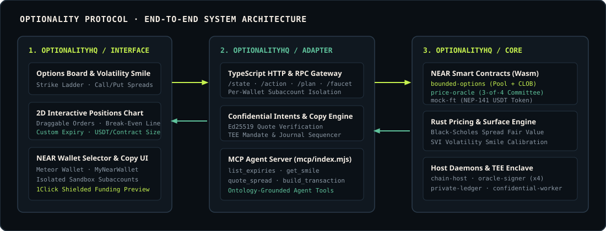
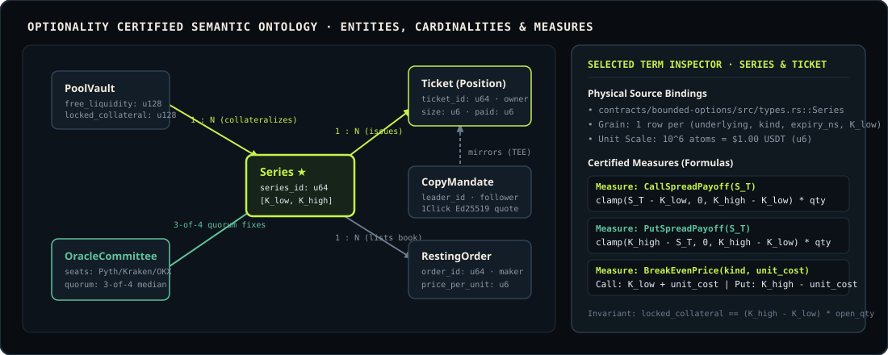

<div align="center">


<br />

[](https://github.com/OptionalityHQ/adapter)
[](./mcp)
[](./api/src/confidential-intents.ts)
[](https://github.com/OptionalityHQ/adapter)

**NEAR RPC Gateway Adapter, Per-Wallet Subaccount Isolation, 1Click/Intents Confidential Funding & MCP Server for Optionality**

[Live Gateway](https://optionality.pro) · [Protocol Docs](https://optionality.pro/docs) · [Semantic Ontology](./docs/ONTOLOGY.md) · [Core Repo](https://github.com/OptionalityHQ/core) · [Interface Repo](https://github.com/OptionalityHQ/interface)

</div>

---

## Overview

Agents and trading interfaces can read raw blockchain RPC responses, but reliability gates derivative execution: a quote or position mark is worse than useless if it mixes expiries, leaks wallet state across sessions, or accepts an unverified funding payload.

**Optionality Adapter** (`OptionalityHQ/adapter`) is the semantic and transport layer between [Optionality Core](https://github.com/OptionalityHQ/core) (NEAR smart contracts + Rust pricing engine) and any human or AI consumer ([Optionality Interface](https://github.com/OptionalityHQ/interface), CLI scripts, or MCP-compatible AI agents).

It enables developers and agents to:

- **Ground** — Aggregate raw NEAR contract views (`get_series`, `get_book`, `get_bids`, `get_positions`) and Rust engine marks into a single certified state payload (`GET /state`) where every number names its provenance.
- **Isolate** — Automatically provision a dedicated on-chain NEAR subaccount (`w-<slug>-<hash>.<admin>`) per connected wallet so balances, open positions, and trade histories are strictly isolated.
- **Plan & Sign** — Build human-readable, slippage-bounded transaction plans for both non-custodial browser wallets (`POST /plan`) and sandbox execution (`POST /action`).
- **Verify Confidential Funding** — Cryptographically verify Ed25519 provider signatures on 1Click / NEAR Intents shielded funding quotes before admitting copy-trading mandates.
- **Expose via MCP** — Serve live option chains, volatility smiles, spread quotes, and unsigned NEAR transaction payloads to any AI agent harness over the Model Context Protocol (`mcp/index.mjs`).

<p align="center">
  
</p>

---

## Software Components

| Module / Path | Technology | Role | Port / Transport |
| :--- | :--- | :--- | :--- |
| [`api/src/server.ts`](./api/src/server.ts) | Node.js 22+, TypeScript | HTTP Gateway serving `/state`, `/action`, `/plan`, `/chart-quote`, `/copy/*` | `127.0.0.1:8790` (HTTP) |
| [`api/src/chain.ts`](./api/src/chain.ts) | `near-api-js` | NEAR RPC client, per-wallet subaccount isolation & gas manager | NEAR JSON-RPC |
| [`api/src/actions.ts`](./api/src/actions.ts) | TypeScript | Slippage-checked transaction planner & human-readable sentence generator | In-process |
| [`api/src/gather.ts`](./api/src/gather.ts) | TypeScript | Multi-contract state aggregator, cell registry & position mark-to-market | In-process |
| [`api/src/gateway.ts`](./api/src/gateway.ts) | TypeScript | NEP-141 $u_6$ atom converter, unsigned transaction builder & UTC faucet quota | In-process |
| [`api/src/confidential-intents.ts`](./api/src/confidential-intents.ts) | `@defuse-protocol/one-click-sdk` | Ed25519 signature verifier for 1Click / NEAR Intents confidential funding | HTTPS / Ed25519 |
| [`api/src/copy-trading.ts`](./api/src/copy-trading.ts) | TypeScript | CEX-style leaderboard, TEE mandate lifecycle & zero-front-running journal | REST (`/copy/*`) |
| [`mcp/index.mjs`](./mcp/index.mjs) | MCP (`stdio`) | Model Context Protocol server for AI agents (Claude Code, Codex, Cursor) | `stdio` JSON-RPC |

---

## How It Works & Agent MCP Walkthrough

<p align="center">
  
</p>

When an AI agent connects to Optionality through [`mcp/index.mjs`](./mcp/index.mjs), it queries certified ontology measures rather than guessing contract arguments:

### Example 1: Quoting a Downside Protection Spread via MCP

> **User:** *"How much does it cost to hedge 5 ETH against a drop below $2,400 for the next 24 hours, and what is my break-even?"*

```text
Agent -> MCP tool: quote_spread({ asset: "ETH", kind: "Put", strike: 2400, quantity: 5 })

Answer:  Protecting 5 ETH with a $2,300–$2,400 Put Spread (width $100.00/ct)
         costs $118.45 USDT total ($23.69 per contract, including 50 bps LP fee).

Measures:
  • Spread Range:       $2,300.00 – $2,400.00 (Max Payout: $500.00 USDT locked in vault)
  • Total Premium:      $118.45 USDT (Max Possible Loss)
  • Break-Even Price:   $2,376.31 ETH (K_high $2,400.00 - $23.69 unit cost)
  • Max Net Profit:     +$381.55 USDT (+322.1% ROI if ETH settles <= $2,300.00)
```

### Example 2: Refusing an Unlisted Expiry (Fail-Closed Ontology Check)

> **User:** *"Buy 2 BTC Call spreads on an expiry that has already closed."*

```text
Agent -> MCP tool: plan_action({ type: "buy", asset: "BTC", kind: "Call", strike: 85000, expiry: "1700000000000000000", quantity: 2 })
Error:   Refused before signing — series has already passed its accept_until_ns window.
         Use list_expiries to select an active open series.
```

---

## HTTP API Reference

| Method & Route | Description | Auth / Signing Mode |
| :--- | :--- | :--- |
| `GET /config` | Returns active network (`sandbox` or `testnet`), contract IDs, and demo accounts | Public |
| `GET /state?asset=ETH&kind=Call&account=<id>` | Returns full strike ladder, volatility smile, oracle committee status, balances & positions | Per-wallet isolated |
| `GET /chart-quote?asset=ETH&kind=Call&price=2400&quantity=2.5` | Computes real-time Black-Scholes spread quote, fee breakdown, max payout & break-even | Public |
| `POST /action` | Executes a trade, close, settle, or deposit on the sandbox venue for `account` | Sandbox signer |
| `POST /plan` | Returns unsigned NEAR transaction envelopes for browser wallet signing | Non-custodial wallet |
| `POST /demo/reset` | Mints & deposits `+$1,000.00 USDT` into the caller's isolated sandbox venue account | Per-wallet isolated |
| `GET /copy/leaderboard` | Returns ranked strategy leaders with 30d ROI, Sharpe, win rate, and follower count | Public |
| `POST /copy/subscribe` | Verifies a 1Click confidential funding quote and registers a TEE copy-trading mandate | Ed25519 verified |

---

## Quickstart

### 1. Clone & Run the 96-Test Verification Suite

```bash
git clone https://github.com/OptionalityHQ/adapter.git
cd adapter
npm install
npm test
```

Expected output:

```text
✔ the asset and kind defaults are the screen's defaults
✔ a buy with nobody resting goes to the pool, at the venue's own mid
✔ a held buy pays the mid for every contract, not just the first
✔ accepts the provider-signed advanced preview for a shared Intents balance
✔ economic quote tampering invalidates the provider signature
✔ getLeaderboard returns CEX-style top traders with nicknames, contacts, volume, ROI, and 1-word strategy
✔ mandate creation, retrieval and revocation lifecycle
✔ unsigned transactions preserve visitor, token recipient, gas and attached deposit
✔ faucet quotas survive restart and reset at the UTC boundary
ℹ tests 96 | pass 96 | fail 0
```

### 2. Start the Gateway Server

```bash
node api/src/server.ts --session data/chain-session.json --port 8790
```

### 3. Connect the MCP Server to Claude Code / Cursor

```json
{
  "mcpServers": {
    "optionality": {
      "command": "node",
      "args": ["mcp/index.mjs"],
      "env": {
        "OPTIONALITY_GATEWAY_URL": "http://127.0.0.1:8790"
      }
    }
  }
}
```

---

## Documentation Index

- [`docs/ONTOLOGY.md`](./docs/ONTOLOGY.md) — Certified Domain Ontology (Questions, Terms, Relationships, and Mathematical Measures)
- [`docs/01-overview-and-gap-analysis.md`](./docs/01-overview-and-gap-analysis.md) — Protocol overview & market design
- [`docs/02-theoretical-framework.md`](./docs/02-theoretical-framework.md) — Bounded spread payoff & Black-Scholes math
- [`docs/06-threat-model.md`](./docs/06-threat-model.md) — Security invariants & adversarial threat model
- [`docs/09-runbook.md`](./docs/09-runbook.md) — Operator runbook & HTTP route table
- [`docs/10-private-copy-trading-tee.md`](./docs/10-private-copy-trading-tee.md) — Confidential copy trading & 1Click Intents specification
