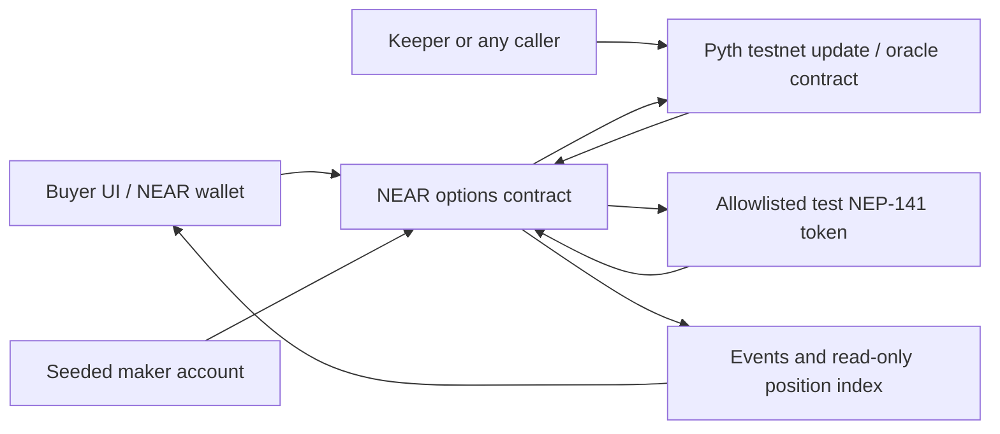
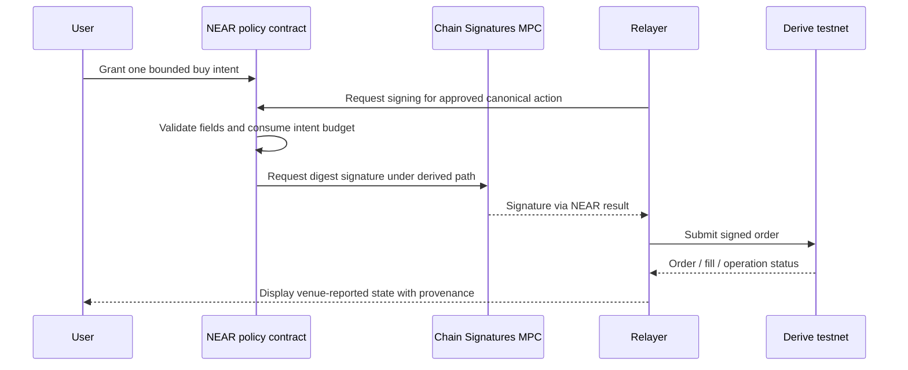

# 1 · NEAR hackathon MVP

> **Ours.** Reference material on other venues is in [reference/](reference/) · index: [docs/README.md](README.md)

**PROPOSED, with option A partly built.** Design decisions below are still proposals; option A now has local contract code, sandbox tests and a market simulator (see [the prototype](../near-mvp/README.md)). Nothing has been deployed, and no external integration has been transaction-tested. No particular hackathon, deadline or eligibility rule has been assumed.

## Recommendation

Do not clone Derive's entire exchange. Build one complete user outcome with real authorization, collateral accounting, expiry and payout.

A first-stage implementation of option A now exists in [the NEAR prototype](../near-mvp/README.md): Rust contracts, a mock NEP-141 token, an oracle adapter, and passing sandbox tests. It is **not deployed** and still uses a trusted testnet oracle and seeded maker.

| Design element in this document | Build status |
|---|---|
| Immutable series policy, offer/ticket escrow, settlement, void, async withdrawal | Implemented, sandbox-tested |
| Limit fill of one funded offer | Implemented, sandbox-tested |
| On-chain market order sweeping a per-series book with a premium budget | Implemented (`fill_market_order`, `get_book`, `prune_offers`), sandbox-tested |
| Acceptance-test suite: conservation at every quiescent point | Implemented, asserted in every flow |
| Market economics study (premium vs collateral, maker ROI, slippage, fill rate) | Simulated locally against the same integer ledger, [report retained](../evidence/MANIFEST.md#evidencesim20261028marketreporttxt) |
| Live BTC/ETH price ingestion (Binance + Coinbase + Bybit streams, median, dispersion, staleness) | Implemented for the demo and the economics study. It is one seat at the settlement committee, which now needs a quorum of independently signed prices before a ticket pays |
| Derive-shaped trading screen (chain ladder, two-leg ticket, payoff/greeks, book, positions) | Built on that live feed, still not connected to a deployed contract |
| Real oracle callback, funded makers, storage rent, audit, deployment | Not done |

The simulator is not decorative: `testdata/accounting-vectors.json` is asserted by both the Rust tests and
the JavaScript tests, and the demo's sweep-then-settle flow must reproduce the sandbox test's
`108 / 97 / 95` balances. That is what keeps a hard-coded UI from quietly disagreeing with the contract.

**Default for a reliable protocol demo:** a NEAR-native, fully collateralized, cash-settled put-spread ticket. It offers capped downside protection over a stated price interval. One maker and one collateral token are enough to demonstrate the complete lifecycle without inventing portfolio margin, liquidation or an insurance fund.

**Alternative with stronger existing-liquidity leverage:** a NEAR policy-controlled account that buys an option on Derive using Chain Signatures. This avoids rebuilding an exchange, but signature compatibility, testnet execution and external-state reconciliation must be proved first. It is an integration product, not a NEAR-native options settlement protocol.

| Decision | A. Native bounded ticket | B. Policy-controlled Derive account |
|---|---|---|
| First user | Crypto holder wanting a simple capped hedge | NEAR user/treasury wanting constrained access to Derive |
| User job | Buy a defined payout without navigating an options chain | Authorize a strict execution budget without handing an agent unrestricted trading keys |
| Settlement/custody | NEAR contract holds test collateral and settles ticket | Derive contracts hold venue collateral; NEAR controls signing policy |
| NEAR contribution | Rust contract, NEP-141 ledger, enforceable payoff | Contract authorization and Chain Signatures |
| Main benefit | Complete lifecycle under our control | Reuse venue instruments, liquidity and risk infrastructure |
| Main cost | Must recruit/fund makers; capital inefficient | Inherits Derive access, margin, governance and liveness dependencies |
| Hardest gate | Correct authenticated expiry observation | Derived account accepted by Derive end to end |
| Honest demo claim | A working testnet contingent-payoff market | A NEAR-enforced signature policy for a third-party venue |

Choose one core. Do not combine both settlement engines, Intents, a vault, an AI trader and a TEE into the first build.

## Where the actual product opportunity is

RFQ and structured options are not new. [Rysk's documented product](https://docs.rysk.finance/getting-started/protocol-and-product/how-it-works) already uses RFQ auctions for covered calls and cash-secured puts; [Derive's public terminal](https://app.derive.xyz/trade/options) already has strategy building and payoff views. A bounded Grid catalog lookup returned no Derive/Rysk matches, which is a catalog limitation, not evidence of an empty market.

The testable differentiation is **outcome-first UX or enforceable execution policy**:

- “Spend at most this premium to receive up to this payout if ETH falls through this interval.”
- “This agent may buy only this approved option, before this deadline, within this lifetime budget.”

Neither wording implies full insurance. Capped payouts, basis risk, expiry, fees and oracle failure must be prominent. An attractive chart alone is not differentiation; interview target users about the hedging decision and compare the complete cost with doing the same trade directly on an existing venue.

## A. Native bounded protection ticket

### Scope

| Build for real | Safe to fix/template | Exclude |
|---|---|---|
| NEAR wallet authorization and token deposits | One ETH/USD market | Naked shorts, leverage and liquidations |
| Maker-funded collateral and immutable offer terms | One put-spread template | CLOB, perps, PM and cross-currency netting |
| Atomic internal-ledger acceptance | A few strikes/expiries | Vault shares, pooled LP funds and yield claims |
| Authenticated oracle callback and settlement | One seeded testnet maker | Mainnet bridges or real-money deposits |
| Idempotent payout credit and token withdrawal | Seeded quotes clearly labeled as such | Transferable positions and early exercise |
| Failure/replay/rounding tests | Zero protocol fee for the demo | Production fee claims and invented liquidity |

This is one composite payoff, not separately transferable long/short option tokens. That scope cut removes leg reconciliation and token-market complexity while preserving the economics of a put spread.

### Payoff and capital accounting

Let `K_high > K_low`, quantity `q`, expiry price `S_T`, and buyer premium `P`:

```text
payoff(S_T) = q × clamp(K_high − S_T, 0, K_high − K_low)
M = q × (K_high − K_low)
buyer P&L = payoff − P
maker P&L = P − payoff
```

`M` is the maximum payout and is fully funded by the maker. For the prototype, hold the buyer premium in escrow until the outcome is finalized. This is deliberately less capital efficient than allowing premium reuse, but makes an oracle-outage refund possible without clawing funds back from the maker.

**Illustrative only, not a market quote:** `q=1`, strikes `110/100`, premium `3`, maker collateral `10`, no fees.

| Expiry price | Buyer payout | Buyer P&L | Maker returned collateral + premium | Maker P&L |
|---:|---:|---:|---:|---:|
| 120 | 0 | −3 | 13 | +3 |
| 105 | 5 | +2 | 8 | −2 |
| 90 | 10 | +7 | 3 | −7 |

Before expiry, the ticket holds `M + P = 13`. Settlement distributes exactly 13 between buyer and maker. On a precommitted oracle-outage void, the buyer receives 3 and maker receives 10. **Never credit the premium as spendable maker funds and also count it as refundable escrow.**

Use integer/fixed-point arithmetic. Define price scale, quantity scale and token decimals once; round maximum liability upward and payout downward into token units, then derive maker remainder from the actual locked amount. Use checked wide intermediates, reject overflows, and assign every rounding remainder deterministically. No floating-point financial state.

### Minimal architecture



| Component | Minimal responsibility |
|---|---|
| UI | Choose ticket, disclose capped payoff/price/expiry, approve deposit/fill, show status and withdrawal |
| Rust options contract | Available balances, offer reservations, premium escrow, tickets, settlement snapshots, pending withdrawals |
| Mock NEP-141 token | Explicitly worthless test collateral with known decimals; not represented as real USDC |
| Maker process/account | Post authorized, funded offers and cancel only unfilled offers |
| Keeper | Submit oracle updates and trigger settlement; no authority to set arbitrary prices or recipients |
| Index/read layer | Display contract state/events; not authoritative for balances or payouts |

A single Rust contract should own the ledger and payoff logic. Funds first enter through `ft_transfer_call`; subsequent trade acceptance happens within one contract receipt, without an external token transfer during matching.

### Offer and ticket state

Avoid offchain maker signatures in the first version: the maker posts an offer using its NEAR account, and the contract reserves the maximum liability immediately. This is a firm onchain offer/RFQ response rather than an offchain low-latency auction.

```text
Offer: Funded → Filled
             → Cancelled
             → Expired

Ticket: Open → AwaitingOracle → Settled
                             → VoidedAfterOracleDeadline

Withdrawal: Pending → Succeeded
                    → FailedAndBalanceRestored
```

Create each market/expiry series once, binding its immutable oracle-policy version before any offers are posted. Its policy cannot be replaced after creation. Offer fields bind that series, maker, optional designated taker, token, quantity, strikes, premium and quote deadline. A filled offer cannot be cancelled. An individual offer is always taken whole; a market order may therefore fill **part** of the size it requested and reports the unfilled remainder. All tickets in the series use its one stored settlement snapshot and the same confidence/timing rules.

For the market order the contract keeps only a per-series list of open offer ids, sorts them by premium per unit, and takes whole offers until the requested size or the caller's `max_total_premium` budget is exhausted. No spot price, auction or sequencer is involved; the budget *is* the price control, and one ticket is created per offer taken because each ticket carries its own maker's collateral and premium. This is the smallest honest step from "fill this quote" to "execute this order", and it is where a real venue would eventually substitute offchain matching.

At acceptance, check the offer state, taker restriction, quote deadline, expiry and buyer balance; convert the maker reservation into ticket collateral and debit premium into escrow atomically. Cancellation/expiry releases only unfilled collateral. Concurrent fill/cancel attempts are resolved by committed contract execution order, not the UI.

### End-to-end journey

1. **Prepare test accounts.** Buyer and maker have testnet NEAR for gas/storage and the test token. Label faucets and balances clearly. This is a narrow crypto-user demo, not proof of frictionless mainstream onboarding.
2. **Deposit.** Allowlisted token invokes `ft_on_transfer`; contract authenticates the token predecessor and credits only accepted amounts. Unsupported token calls must not credit the ledger.
3. **Fund offer.** Maker posts immutable terms and reserves `M`. Offer validity expires before option expiry.
4. **Accept.** Buyer authorizes the fixed premium and terms. A single contract execution creates the ticket and escrow entries.
5. **Observe expiry.** Keeper updates the allowlisted oracle; the options contract reads it through an authenticated callback and records an eligible shared snapshot.
6. **Settle.** Any caller triggers deterministic accounting from that snapshot. Ticket state changes once; buyer/maker credits are created exactly once.
7. **Withdraw.** Each owner withdraws available balance to their own registered token account. Token transfer is asynchronous; the UI waits for its actual result rather than treating the request as payment.

### Oracle policy: explicit testnet boundary

[NEAR's oracle documentation](https://docs.near.org/primitives/oracles.md) lists Pyth at `pyth-oracle.testnet`, with test Hermes and network-specific feed IDs. That establishes a documented integration route, not verified current feed availability or historical-update behavior.

**Proposed testnet policy:** before selling any ticket, pin the feed ID, oracle account, normalization, confidence limit and timing windows in an immutable policy version. As illustrative demo constants, accept an authenticated observation with publish time in `[expiry, expiry + 60 seconds]`, and require the callback to commit by `expiry + 600 seconds`. The first eligible callback committed on NEAR fixes the shared expiry price. Reject nonpositive prices, wrong feeds, out-of-window timestamps and excessive confidence intervals; normalize the signed exponent safely.

After the 600-second deadline, if no snapshot exists, anyone may void affected tickets and return `P` to the buyer and `M` to the maker. A callback arriving after the deadline cannot revive a voided ticket. Windows are a proposed test policy, not a recommended production oracle standard.

**Economic caveat:** first-accepted publication permits some timing/selection influence within the window. An outage void can remove an otherwise valuable hedge and can create incentives to withhold updates. Permissionless submission and multiple keepers reduce dependence on one operator but do not prove fair observation selection. A public-money product needs a reviewed deterministic fixing/TWAP policy and outage economics; do not silently replace Pyth with an administrator price or claim the prototype solved this.

An early integration gate must prove the actual testnet oracle callback returns usable data under this policy. If unavailable, a separately deployed, visibly labeled fixture oracle can exercise the accounting demo, but that is **not** completion of the live-oracle integration and must be reported as such.

### NEAR asynchronous execution requirements

[NEAR cross-contract calls](https://docs.near.org/smart-contracts/anatomy/crosscontract.md) are separate receipts, not synchronous Ethereum-style calls. Later failure does not automatically roll back prior successful state changes.

- `ft_on_transfer` authenticates the allowlisted token account and validates the deposit message. Returned unused amounts are handled by the token resolver; [refunds are bounded by the transfer and receiver's remaining balance](https://docs.near.org/smart-contracts/security/cross-contract-calls/ft-transfer-call.md).
- Trading uses predeposited balances, so fill accounting does not depend on two asynchronous token transfers.
- Withdrawal debits/reserves balance before sending. A private callback marks success or restores balance only after a known failed transfer, keyed by one withdrawal ID.
- Do not restore balance merely because a timeout occurred: a transfer may have succeeded while its callback failed. [Callback failures](https://docs.near.org/smart-contracts/security/cross-contract-calls/callback-failures.md) require an explicit pending state and verified reconciliation, not a blind resend.
- Pre-register token storage, attach required gas/deposit, and test the standard FT transfer's 1-yocto requirement. Provision storage separately from option collateral.
- Oracle reads cannot hold a contract execution open across receipts; callback state checks must reject obsolete, duplicate and late results.

A single allowlisted standard test token keeps recovery tractable. For an unresolved callback failure, retain the pending withdrawal and recover only after validating its receipt outcome; any manual testnet reconciliation authority must be disclosed. Mainnet needs a reviewed receipt-proof or equivalent recovery design, not a timer-based credit.

### Accounting invariants and acceptance tests

For quiescent states, test-token custody must equal:

```text
sum(available balances)
+ unfilled offer reservations
+ open-ticket maximum-payout collateral
+ open-ticket premium escrow
```

During withdrawals, track each pending debit and the token transfer/receipt result separately; temporarily in-flight value cannot be counted as both spendable custody and delivered payout.

| Test | Required result |
|---|---|
| Wrong token or forged callback | No credit or state change |
| Maker reserves same funds twice | Second offer rejected |
| Expired/cancelled/already-filled offer | Fill rejected |
| Simultaneous fill and cancellation | Exactly one valid transition |
| Insufficient buyer premium | No partial creation or debit |
| Prices above/between/below strikes | Exact bounded payoff and conservation |
| Decimal edge/large inputs | Defined rounding; overflow rejected |
| Stale/wrong-feed/low-confidence oracle | No settlement snapshot |
| Duplicate oracle/settlement callback | No overwrite after fixation and no duplicate credit |
| Oracle deadline versus late callback | Exactly one settlement/void outcome |
| Outage void | Full premium refund and maker reservation release |
| Successful/failed token withdrawal | Correct debit or one restoration, never both |
| Lost callback / unknown transfer result | Remains pending; no unsafe retry/refund |
| Maker disappears after fill | Existing ticket still settles without maker approval |
| Sweep with offers at different unit premiums | Cheapest unit premium first, regardless of absolute premium |
| Sweep larger than book depth or budget | Partial fill reported, unfilled size disclosed, or revert on `min_quantity` |
| Sweep over own / reserved / expired offers | Those offers are skipped, never taken |
| 200 expired quotes occupying a series book | `prune_offers` frees the index, escrow and records untouched |
| Sweep cost vs budget | Realized and worst unit premium returned and emitted |
| Contract math vs UI math | Both assert the same frozen vector file, and the demo reproduces the sandbox balances exactly |

Every row is implemented as a test today except "simultaneous fill and cancellation", which needs a
concurrent-receipt harness rather than a sequential sandbox script, and worst-case sweep gas, which is
bounded by the 200-offer cap but not yet benchmarked. The results are in
[the verification transcript](../evidence/MANIFEST.md#evidencemvpverification20261028md).

Golden-path demo: maker deposit → offer → buyer deposit → fill → real authenticated expiry observation → settle → actual token withdrawal. Also demonstrate a rejected duplicate fill and a stale-oracle/outage scenario.

## B. NEAR-controlled execution on Derive

### Smaller, stronger integration claim

Instead of recreating the venue, let a NEAR contract control a derived Ethereum account. Start with **one buy-only ETH option template**, not arbitrary spreads, shorting or portfolio rebalancing. Derive remains responsible for trading, collateral, margin, expiry and withdrawal processing.

[Chain Signatures](https://docs.near.org/chain-abstraction/chain-signatures.md) can sign external-chain payloads. The [implementation guide](https://docs.near.org/chain-abstraction/chain-signatures/implementation.md) describes secp256k1 signing, and [EIP-712](https://eips.ethereum.org/EIPS/eip-712) defines Derive's typed-action hash construction. This is plausible compatibility, **not a tested Derive integration**.



### Non-negotiable policy rules

- Derivation depends on the **calling NEAR account, path and MPC master key**. For contract-mediated signing, that caller is the contract, not automatically the user. Bind each path to the correct user; paths are identifiers, not secrets.
- The contract computes or verifies the canonical EIP-712 digest from constrained fields. Never expose “sign this arbitrary hash.”
- Bind venue domain, chain ID, module, owner, signer, subaccount, protocol asset/sub-ID, buy direction, amount, price, maximum fee, nonce and expiry. Validate instrument encoding against a pinned allowed instrument, not untrusted relayer labels.
- The first version consumes the full worst-case premium-plus-fee budget when signing. It does not automatically recycle budget on an API rejection or timeout. This conservative lifetime-budget rule avoids relying on an unproven external-state oracle.
- Persist the intent before the MPC request. Retries may only reproduce the same authorized digest; do not mint a new nonce and a second order because the first result is uncertain. Verify Derive's replay/idempotency behavior in tests.
- API login and any key registration also need constrained signing methods. A broad relayer session key would bypass the claim that every trade passes the NEAR policy.
- Provide a separate withdrawal-signing method authorized only by the recorded NEAR user, never by the trading agent. Bind the venue domain/module, derived owner, subaccount, token, underlying amount, fee cap, nonce, expiry and approved recipient. For the demo, the recipient is the same derived account on Sepolia. Use an independent one-time authorization; do not replenish the consumed trading budget or expose arbitrary transfer signing. Test recipient-whitelist requirements at Derive.
- NEAR account access keys and upgrade authority are part of custody control. If a developer key can replace policy code, disclose that testnet power; do not market it as immutable user-only custody.

MPC does not validate Derive's typed schema for us, provide EVM gas, prove venue state back to NEAR or make the trade atomic across chains. A signed EIP-712 action is not an Ethereum transaction; deposits/withdrawals and transaction broadcasting have additional gas/nonce/finality requirements. Receipt of a venue withdrawal by the derived Sepolia account completes this demo; forwarding those funds elsewhere would require another explicit owner-authorized, recipient-bound transaction, not agent discretion.

### End-to-end compatibility gate

Before committing the hackathon to B, demonstrate on testnet:

1. Deterministic derived secp256k1 address and signature recovery, including correct `r/s/v` and low-s handling.
2. Exact Derive typed-action digest test vectors, especially the `Matching` domain, chain ID and verifying contract from the architecture document.
3. Derived-account login/onboarding and a usable Derive subaccount.
4. Authorized faucet/test-collateral deposit actually credited; no mainnet substitution.
5. A buy order accepted and filled, with bounded spend. If testnet liquidity is absent, identify that limitation or arrange an explicitly permitted funded test maker; do not show a simulated fill as live.
6. The agent signing path rejects a different instrument, oversized budget, sell order, transfer/withdrawal action, expired intent and replay. The separate user-only withdrawal path rejects agent callers and altered recipients/amounts.
7. The lifecycle is traceable through venue operation/batch state, option expiry and an owner-authorized testnet withdrawal actually received by the derived account.

Derive's public production and testnet universe endpoints responded during research; authenticated actions and token funding were not tested. Venue margin requirements must be queried, not inferred from payoff charts. Testnet market calendars may also make an expiry demo slower than A's configurable test contracts.

**Reconciliation limit:** a relayer/API receipt is venue-reported evidence, not a trustless state proof consumed by NEAR. Show separate statuses for NEAR authorization, MPC signature, Derive acceptance, fill, batch settlement and withdrawal receipt. Dynamic reusable budgets and position-aware policies belong after a credible external-state verification design.

## Which NEAR technologies belong?

| Technology | Role | Decision for first MVP |
|---|---|---|
| Rust NEAR contract | Ledger/payoff in A, signing policy in B | Core |
| NEP-141 | Actual test-token accounting in A | Core for A |
| Chain Signatures | Derive-compatible signing under NEAR policy | Core only for B; unnecessary for native settlement |
| Pyth on NEAR testnet | Authenticated expiry data in A | Integration gate; third-party oracle, not NEAR consensus price |
| NEAR Intents / 1Click | Possible future spot funding/conversion route | Defer; not an options settlement engine |
| Shade/TEE agent | Potential private automation later | Defer; maintenance and need not established |
| AI interface | Explain/build a restricted proposal | Optional presentation layer; never custody or price authority |

The [1Click production specification](https://1click.chaindefuser.com/docs/v0/openapi.yaml) and [supported-token API](https://docs.near-intents.org/api-reference/oneclick/get-supported-tokens.md) do not establish arbitrary test-token or testnet support. `dry:true` is a quote preview, not a testnet swap. Routes have variable fees/minimums; do not claim free universal cross-chain funding. [Chain support](https://docs.near-intents.org/resources/chain-support.md) and [fees](https://docs.near-intents.org/resources/fees.md) must be rechecked for a specific future route.

A user expressing an options “intent” in our UI is not automatically an integration with NEAR Intents. Those names should not be conflated in a demo.

## Economics, access and production gates

| Stakeholder | Why use it? | What the demo does not establish |
|---|---|---|
| Buyer | Simpler capped hedge or constrained venue access | Willingness to pay after all fees and basis risk |
| Maker | Earn premium for taking contingent risk | Competitive risk-adjusted return or affordable hedging |
| App/operator | Distribution and possibly later disclosed service fees | Sustainable revenue after support, infrastructure and compliance |
| Keeper/relayer | Operating role initially funded by team | Reliable decentralized supply or profitable fee model |

A has no organic liquidity proof: team-funded test collateral is a demo input. Before production, model maker capital lockup, expected payout, adverse selection, hedging cost, oracle timing risk and operational fees. Do not quote APR by annualizing one premium or set an arbitrary fee and call the model validated.

B inherits an established venue design but not guaranteed testnet/mainnet liquidity or a commercial integration agreement. Its value must exceed the friction of funding a derived account and using a new interface.

Both are derivatives products. Chain choice, decentralization, testnet success or calling a put spread “protection” does not remove legal obligations. For a public-money release, determine target jurisdictions, user eligibility, sanctions/geographic restrictions, licensing and solicitation rules with qualified advice. Derive's exploration of US markets is not permission for our app to serve US users. A browser demo avoids app-store distribution work initially; any native/mobile distribution requires a separate current platform-policy review. No compliance bypass is part of either design.

Mainnet additionally requires audit/build provenance, reviewed oracle fixing/outage policy, safe upgrades/recovery, real token/depeg behavior, monitored keepers, abuse limits and evidence of maker/user demand. Expand markets or makers before adding leverage; pooled vaults and portfolio margin change the risk model and are separate projects.

## Build sequence and definition of done

1. **Resolve one external gate first:** real testnet oracle callback for A; derived-account Derive signing/funding/fill for B.
2. **Prove core arithmetic/authorization:** conservation and state-machine tests for A; canonical payload/budget/replay tests for B.
3. **Connect one funded lifecycle:** no dashboards before token credit, operation state and payout work.
4. **Build three screens:** quote/policy selection, exact confirmation, position/status/withdrawal.
5. **Demonstrate failure behavior:** duplicate, expired input, unavailable external dependency and pending payout.
6. **State boundaries on screen:** test collateral, seeded liquidity, fixture data if any, venue-reported versus verified state, and administrator powers.

A prototype is complete only when its selected live integration and actual payout path work, not when a hardcoded chart reaches “success.” The next design decision is whether to own the small payoff protocol (A) or the constrained access workflow (B); the latter is more dependent on external compatibility but avoids building a new liquidity venue.

## Primary technical references

- [NEAR Rust contract quickstart](https://docs.near.org/smart-contracts/quickstart.md).
- [NEP-141 standard](https://github.com/near/NEPs/blob/master/neps/nep-0141.md) and [FT primitives](https://docs.near.org/primitives/ft).
- [Cross-contract calls](https://docs.near.org/smart-contracts/anatomy/crosscontract.md), [callback failures](https://docs.near.org/smart-contracts/security/cross-contract-calls/callback-failures.md), [FT refund behavior](https://docs.near.org/smart-contracts/security/cross-contract-calls/ft-transfer-call.md).
- [Chain Signatures](https://docs.near.org/chain-abstraction/chain-signatures.md), [implementation](https://docs.near.org/chain-abstraction/chain-signatures/implementation.md), [pinned MPC signing API source](https://github.com/near/mpc/blob/d0fc87b19e2643299e7becdd7d9611afcd5d5a78/crates/contract/src/api/sign.rs).
- [EIP-712](https://eips.ethereum.org/EIPS/eip-712), [NEAR oracle integration](https://docs.near.org/primitives/oracles.md).
