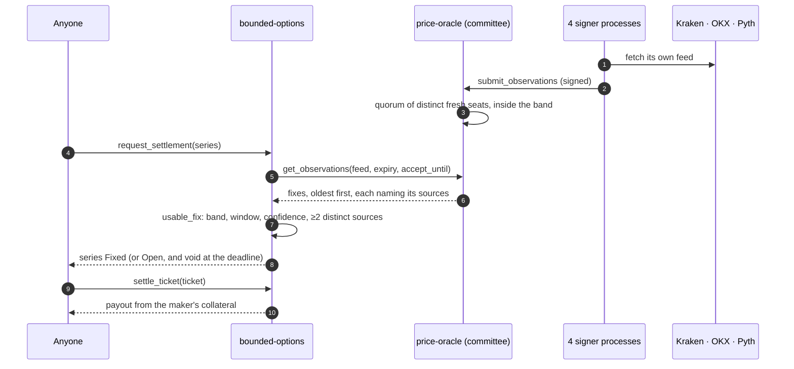

# 2 · On-chain integration

> **Ours.** Reference material on other venues is in [reference/](reference/) · index: [docs/README.md](README.md)

## The chain path that works now

One command, all local, no keys of yours and no testnet:

```bash
bash scripts/venue.sh start     # build.sh, then engine → chain-host → gateway
```

`chain-host` boots a real NEAR sandbox (the same runtime a validator runs),
deploys `bounded_options`, `mock_ft` and `price_oracle`, creates nine accounts
with real keypairs, funds each with 5,000,000 USDT, deposits them into the
market, and writes `data/chain-session.json` with the RPC address and the keys.
It then lists the series the engine asks for and parks: the sandbox lives and
dies with that process.

[`api/src/chain.ts`](../near-mvp/api/src/chain.ts) is the Node client —
`near-api-js` signing against `127.0.0.1:<port>`. The gateway runs every
lifecycle through it: one where the counterparty is a person resting a quote,
one where it is the pool.
Evidence: `evidence/chain/2026-10-29-onchain-demo.txt`,
`evidence/chain/vault-lifecycle.txt`, `evidence/chain/ladder-listed.txt`.

| Step | Contract call | What the chain said |
| --- | --- | --- |
| list | `create_series` | series #9 `ETH 2400/2500 Call`, `series_created` event |
| quote | `post_offer` ×3 | offers #21–23 at 0.15 / 0.21 / 0.27, 300 collateral each |
| take | `fill_market_order` | 1 ticket #6 for 0.15, `worst_unit_premium` 0.05 |
| rest | `post_bid` | bid #6, 3 @ 0.12 |
| close | `close_ticket` | 0.12 paid, `you` 4,999,999.67 → 4,999,999.79 |
| fix | `submit_observations` (two seats) + `request_settlement` | `{"Fixed":{"price":2420500000,…}}` via the oracle callback, with `settle_sources` naming who signed it |
| settle | `settle_ticket` | 61.50 to the holder, 238.65 back to the maker |
| audit | `expected_custody` vs `ft_balance_of` | 45,000,000.00 = 45,000,000.00 · conserved |

The payout is the bounded-spread arithmetic in [01-hackathon-mvp.md](01-hackathon-mvp.md), on-chain and
independently checkable: a 2400/2500 call spread on 3 contracts has a 300 maximum
payout, the print fixed it 20.5% of the way through the width, and the holder
received 61.50.

### The same script against the vault

The demo then runs the Player-vs-Pool lifecycle on a second series, which is what
the product is now. Evidence: `evidence/chain/vault-lifecycle.txt`.

| Step | Contract call | What the chain said |
| --- | --- | --- |
| fund | `withdraw`, then `ft_transfer_call` with `"pool-deposit"` | 1,000,000 out to the LP's wallet, 1,000,000 into the pool, 1,000,000 shares at par |
| quote | `set_pool_quote` 0.05 | the venue's price for the series: without it the vault writes nothing at any price |
| write | `pool_buy` 3 with a 0.16 budget | premium **0.156** all-in, worst case **300**, margin inside it **0.006** · 2.3 Tgas |
| state | `get_pool_state` | equity 1,000,000.150 · reserved 299.850 · free 999,700.300 · utilisation 0.02% · margin locked 0.006 |
| greed | `pool_sweep` while the ticket is open | **0.000** — that margin is a void's refund source, not the venue's yet |
| fix | `submit_observations` 2209.00 from two seats, below the low strike | the call expires worthless |
| settle | `settle_ticket` | 0.00 to the buyer, 0.00 to the maker: the vault keeps the premium it collected |
| pay | `pool_sweep` | **0.006**, earned now that no void can call for it |
| exit | `pool_withdraw` | 1,000,000.150 back for 1,000,000 in — the LP's whole return on that risk |
| audit | `expected_custody` vs `ft_balance_of` | 45,000,000.00 = 45,000,000.00 · conserved |

Run twice, identical to the last digit: 18 transactions, 56.9 Tgas for both
lifecycles together. The vault's buckets are inside `expected_custody`, and a pool
ticket adds nothing to the book escrow totals — its money is already in equity and
locked margin — so the reconciliation still lands on the token balance exactly.


### The settlement path, in one picture



The venue never asks who signed; it asks *how many distinct seats did*, and refuses a
number that fewer than two of them put their key to.

## Gas is a call-site decision

`withdraw` attaches 20 Tgas for the token transfer and 25 for its own callback. A
caller that gives it the ordinary 30 Tgas does not get a slow transaction: the
contract panics at the moment it attaches more static gas than it was given, and
because that is before any state write, the debit, the withdrawal record and the
event are all discarded — `stats.withdrawal_count` stayed 0 and custody never
moved. Anything that chains a transfer needs at least 45 Tgas at the call site, so
`chain.ts` passes 90 for it. `pool_buy`, `pool_close` and `settle_ticket` are
single-hop and cost 2–5 Tgas.

## Argument encoding, because it bites

The SDK's JSON is not uniform and the failure is a panic inside the contract:

- `U128` wrapper amounts (`quantity`, `premium`, `price_scale`) → **strings**.
- raw `u128` (the oracle's `price`) → **number**.
- `u64` (`*_ns` timestamps, `series_id`, `ticket_id`) → **number**; a string is
  rejected, and a nanosecond timestamp only loses ~256 ns to double rounding.
- `get_positions` takes `account`, `get_balance` takes `account_id`.

`api/src/chain.ts` keeps those rules in one place (`encode`, and the two readers).

## What is still off-chain, and why that is the right split

| Piece | Where | Reason |
| --- | --- | --- |
| Order book, matching, escrow, settlement, custody | **contract** | This is the product. It must not be trusted. |
| Price index (median of Binance/Coinbase/Bybit prints) | off-chain feed → one seat of the oracle | A contract cannot open a websocket. The feed is one input among four signed sources, and a fix needs a quorum of them plus `min_confidence_bps` — which is what stops one venue, including our own, from settling the market alone. |
| Quote *decisions* (what the pool writes, at what price) | the Rust engine | Deciding a price costs no trust; publishing it does. The engine calls `core::fees`, the same module the contract calls, and the contract still refuses anything outside its bounds. |
| UI, ladder rendering, PnL display | browser | Presentation. |

That was the seam the JavaScript ledger sat on, and the gateway crossed it:
same `/state` + `/action` API, `Chain.call` underneath instead of a book in
memory. The ledger and its parity tests are deleted — one implementation left,
and the page cannot disagree with the chain because it has nothing to compute
with.

## The next step is a decision, not a task

To put this in front of judges on a public chain needs three things that were not
approved in this session: a funded testnet account, a deployed contract, and a
wallet. The code path is `near-api-js`'s `WalletConnection`, already a dependency;
the swap is the session file (a wallet-signed `signAndSendTransaction` per action
instead of a sandbox key). Deployment stays gated until you say so.
