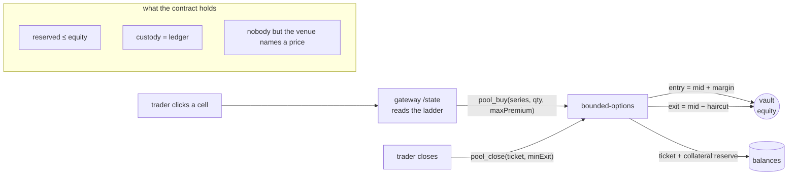

# 4 · Player-vs-Pool architecture

> **Ours.** Reference material on other venues is in [reference/](reference/) · index: [docs/README.md](README.md)
pooled vault, LP capital earns the venue margin, and every fee is inside the
entry premium. Languages: **Rust for anything that computes money, TypeScript for
anything that moves bytes.**

## The one structural idea

The market used to exist twice: `contracts/bounded-options/src/accounting.rs` in
Rust and `sim/{accounting,pricing,market}.mjs` in JavaScript, kept in agreement by
`sim/test/parity.test.mjs`. That is a tax paid forever — every rule must be written
twice and tested against drift. The JavaScript half was deleted on 30 October 2026,
after the engine and gateway could do everything it did.

The fix was one `core` crate, compiled twice.

```
        ┌─────────────────────────────┐
        │        core (Rust)          │  accounting · pricing · pool · fees · index
        └──────┬───────────────┬──────
     wasm32    │               │    native
               ▼               ▼
        bounded-options      engine      both binaries run the same arithmetic,
        (the chain)        (the venue)    so they cannot disagree
                               │
                               ▼
                        api (TypeScript)  HTTP + SSE projection for the screen
                               │
                               ▼
                        web  (TypeScript)  the trader's UI
```

No business logic in TypeScript. The TS layer reads and forwards; it never decides
what a trade costs. That rule is what makes the parity problem actually gone rather
than merely tested.


### One click, end to end



The vault is the counterparty to every click, so the two numbers that matter are the
entry it charges and the exit it pays — both derived from the mid it published itself,
inside `core`, which is also the code the engine quotes with.

## Layout

```
core/                  Rust crate, no near-sdk, no float, no I/O
  src/accounting.rs    payout, max liability, premium split      ← from the contract
  src/pool.rs          capacity, shares, buckets, sweeps          ← new
  src/fees.rs          loaded quote: mid × (1 + s), exit haircut  ← new
  src/consolation.rs   loss weights, pity multiplier, epoch draw ← landed, unwired

surface/               Rust crate, engine-only: the pricing model, in f64
  src/pricing.rs       Black-Scholes spread value, smile, greeks   ← replaced sim/pricing.mjs
  src/index.rs         median of venues, dispersion, confidence,
                       the contract's acceptance filter            ← replaced sim/feed.mjs

contracts/bounded-options   depends on core; keeps only state, auth and storage
contracts/mock-ft           unchanged
contracts/price-oracle      unchanged

engine/                Rust crate: feed (the three venue sockets) · ladder
                       (which series exist) · quote (what they cost) · serve (the
                       index and the payload the gateway reads). std HTTP for its
                       own answers, system TLS for the sockets.
                       Listing is the engine's decision and signing is the chain
                       host's: it reads /plan and sends only the series missing.
api/                   TypeScript (Hono): /state /action /stream for the screen
web/                   TypeScript: the screen
```

Rust over Go, in one line: the contract is Rust, so `core` can be shared with it.
Go would mean a third implementation of the same money.

`pricing` is in `surface`, not `core`, and that is deliberate. A contract must never
evaluate a float, because every validator has to reproduce a number bit for bit;
Black-Scholes needs `f64` and an error function. So the float lives on exactly one
side of the boundary and the only thing `core` ever sees is the integer premium the
engine derived from it. The parity test that used to hold the two implementations
together is now a vector file (`surface/testdata/surface-vectors.json`, 72 rows)
plus one test that reads it, and it checks the *integer* output matches exactly.

## The vault's balance sheet

`core::pool::Pool` is four money buckets and two derived numbers:

| bucket | whose money | may leave the vault when |
| --- | --- | --- |
| `equity` | the LPs, part of it committed | an LP redeems shares and it stays covered |
| `reserved` | not money — the worst case still owed | never; it is a limit, not a balance |
| `venue_locked` | the venue's, but encumbered | never, while its ticket can still be voided |
| `venue` | the venue's, earned | on a sweep, any time |
| `consolation` | the lottery | phase 7 |

Two rules that only became visible once the contract called this code:

- **The margin is split in two.** While a ticket is open, its `venue_cut` is the
  source a void refunds from, so it sits in `venue_locked` and cannot be swept: a
  fee collection that later makes a ticket unsettled-able is a leak, not a fee.
  It moves to `venue` at settlement, early close or void.
- **A sweep never touches `equity`.** Share prices are read against equity alone,
  so collecting fees cannot dilute an LP, and an LP cannot redeem past a worst case.

## Invariants `core` owns

| | rule |
| --- | --- |
| capacity | `Σ open (max_payout − lp_notional) ≤ equity` — a spread's worst case is known before the trade, which is why a pool can underwrite options and cannot underwrite perps |
| custody | token balance = available + book escrows + `equity + venue_locked + venue + consolation`, reconciled on every mutation and readable as `expected_custody` |
| premium-inclusive fees | the user pays `mid × (1 + s)`; nothing is charged as a separate line, so `s` is the entire revenue model and must exceed adverse selection |
| entry ceiling | the premium can never exceed the ticket's own `max_payout`, so an over-marked engine cannot charge more than a ticket can pay |
| mark on entry | a fresh ticket is at a loss of exactly `s × mid`, and the UI must say so rather than let it read as a mistake |
| LP exit | refused whenever it would leave `free equity < reserved`, so no LP escapes in front of a bad settlement |
| consolation | funded from float yield and the fee bucket, never from collateral |

## What this deletes

Nine bot accounts and the taker-rate loop (the pool is always on the other side),
the per-series book as a *requirement* (it stays as an optional overlay for makers
who want to beat the pool's price), `sim/test/parity.test.mjs` (replaced by shared
code, and now deleted with the code it was testing), and the fake IVs that only
existed because a thin book has no quote to solve against — a cell with no implied
vol prints `—` because there genuinely is none.

## Build order

Each phase lands with tests and is useful alone; nothing waits for the whole set.

| # | component | done when | status |
| --- | --- | --- | --- |
| 1 | `core::accounting` | contract's own tests pass against it, unchanged results | ✅ moved; the contract's copy deleted |
| 2 | `surface::pricing` | matches the retired `sim/pricing.mjs` over a strike sweep, integer premium exact | ✅ 72 frozen vectors, 1e-9 tolerance, exact on the boundary |
| 3 | `core::fees` + `core::pool` | capacity can never be exceeded, and custody is conserved under any fill sequence | ✅ 20 tests, incl. a 500-step deterministic sequence |
| 4 | contract depends on `core` | book tests still green *and* a vault lifecycle runs on a real chain | ✅ 62 Rust tests then (125 now), 18 on-chain txs, custody conserved |
| 5 | `engine` | the screen trades against a live pool at real prices, zero bots | ✅ 44 tests, live tape, 72 series listed from `/plan`, and a settlement that pays: one feed print fixes the whole grid and a ticket settles out of `equity` ([evidence](../evidence/chain/settlement-live.txt)) |
| 6 | `api` + `web` in TS | the journey script passes end to end against the TS stack | ✅ gateway on 8790 with 55 tests, serving the page; the JS ledger it replaced is deleted and the screen reads only the gateway |
| 7 | `consolation` + economics harness | 3,000 simulated epochs show the pool solvent and farming still −EV | ◐ `core::consolation` done — the −EV bound is a function and 500 random loss splits prove it; the harness and the contract wiring are open |

Phase 4 landed the vault side of the contract: `pool_buy`, `pool_close`,
`pool_withdraw`, `pool_sweep`, `set_fee_terms`, `set_venue`, a `pool-deposit`
receiver message, and `get_pool_state` / `get_lp_shares`. A ticket the vault wrote
is the one whose `maker` is the contract account, which no caller can forge. It adds
nothing to the book escrow buckets — its money is already inside `equity` and
`venue_locked` — so `expected_custody` grew one term and still reconciles to the
token balance exactly.

The first version of `pool_buy` took its mid from the caller. That was the hole the
red-team pass found and paid out of LP equity, and the shape that closes it is
`set_pool_quote`: the venue publishes a price per series, the vault trades at it or
trades not, and a taker is left with only bounds — a budget on the way in, a floor on
the way out. See [05-red-team.md](05-red-team.md).

Phase 7 is the gate on the whole business: if no `s` survives a directional streak
without pricing users out, the shape is wrong and a simulation should be where we
find that out.
