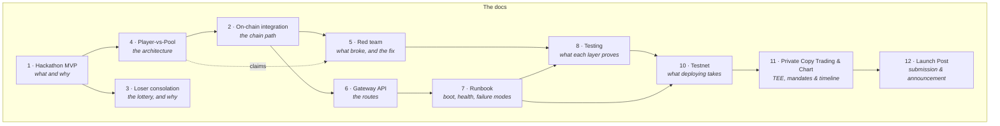

# Docs

Two kinds, kept apart on purpose.

## Ours — what this project builds and proves

## How the pieces relate

Read 1 for the product, 4 for how it is built, 2 and 6 for what executes and how the
screen asks for it, 7 for how to run it, 5 for what has already gone wrong, 8 for
what the tests actually prove, 10 for testnet operations, 11 for private copy trading
and the timeline chart, and 12 for the full submission launch post. Reference material
lives under `reference/` and is never mixed into ours — it is other people's systems,
studied rather than adopted.

Decision records, the agent workflow and the Vietnamese drafts live in an `internal/`
folder that is deliberately not committed; anything worth publishing is rewritten into
these docs rather than moved.

| # | Document | Says |
|---|---|---|
| 1 | [Hackathon MVP](01-hackathon-mvp.md) | the design decision, and what a NEAR-native ticket has to do |
| 2 | [On-chain integration](02-onchain-integration.md) | both lifecycles run against a real chain, with the encoding and gas traps |
| 3 | [Loser consolation](03-loser-consolation.md) | the payout math, and the bound that keeps it unfarmable |
| 4 | [Pool architecture](04-pool-architecture.md) | player-vs-pool: shared Rust crate, four vault buckets, six invariants, phase table |
| 5 | [Red team](05-red-team.md) | what broke and how it was fixed |
| 6 | [Gateway API](06-gateway-api.md) | every route the screen calls |
| 7 | [Runbook](07-runbook.md) | boot, health, stop, failure modes |
| 8 | [Testing](08-testing.md) | the seven layers, the bugs they found, and what is still unproven |
| 10 | [Testnet](10-testnet.md) | live testnet deployment, storage-rent economics, and verified on-chain lifecycle |
| 11 | [Private Copy Trading & Chart](11-private-copy-trading-and-chart.md) | TEE architecture, OutLayer hardware attestation, private ledger, and visual timeline chart |
| 12 | [Launch Post](12-launch-post.md) | public announcement, architecture overview, testnet explorer links, and demo instructions |

Start at **4**, then **2**.

## Reference — other people's systems, studied not adopted

| # | Document | What it is |
|---|---|---|
| R1 | [Product and user flows](reference/derive-1-product-and-flows.md) | Derive's screens and order path, read off the live product |
| R2 | [V3 architecture](reference/derive-2-architecture.md) | Derive's sequencer / SP1 / Celestia / Ethereum settlement design |
| R3 | [Contracts and trust boundaries](reference/derive-3-contracts.md) | their deployed contracts, proof checks and escape conditions |
| R4 | [REA order-path trace](reference/derive-4-order-path-rea.md) | their submission path traced from ticket to signed action |
| R5 | [Interface reconstruction](reference/derive-5-ui-reconstruction.md) | their trading screen, measured from captures |

Nothing in `reference/` is our architecture. Read **R2** only to understand what we
chose not to build: NEAR re-executes every transaction, so a prover, a data-availability
layer and a withdrawal outbox have no job here.
