# R1 · Derive: product and user flows

> **Reference — this is Derive's design, not ours.** Our design: [04-pool-architecture.md](../04-pool-architecture.md) · index: [docs/README.md](../README.md)

Scope: public V3 interface at [app.derive.xyz](https://app.derive.xyz/trade/options), captured 27 October 2026 UTC. Evidence labels follow the index.

## Product model

Derive serves traders, market makers, strategy curators and integrators. Its professional terminal exposes options, perpetuals, spot and RFQ trading around subaccounts and shared margin infrastructure. The offchain trading service supplies responsiveness; proof-backed state transitions and Ethereum contracts govern the settlement boundary. These are separate layers, not interchangeable meanings of “decentralized.”

| Actor | Job | Main dependency |
|---|---|---|
| Options trader | Express a volatility/directional view or hedge a portfolio | Executable quotes, bounded execution price, understandable margin |
| Market maker | Quote instruments or multi-leg packages and manage inventory | API/session-key access, capital efficiency, hedge liquidity |
| Curator | Run a strategy for vault shareholders | Delegated execution, NAV/share accounting, withdrawal capacity |
| Shareholder | Obtain managed exposure without individual order decisions | Curator performance and queue processing; public vault launch not observed |
| Integrator | Build a different experience over the same venue | Authentication, typed actions, account state and operation tracking |

Sources: [RFQ documentation[https://docs.derive.xyz/trading/rfq](https://docs.derive.xyz/trading/rfq), [session keys[https://docs.derive.xyz/authentication/session-keys](https://docs.derive.xyz/authentication/session-keys), [vault request documentation[https://docs.derive.xyz/vaults/deposits-withdrawals](https://docs.derive.xyz/vaults/deposits-withdrawals).

## What the live interface actually showed

### Options terminal

**OBSERVED.** The options page has a dark desktop layout, sidebar navigation, market/expiry selection, a two-sided options chain, a strategy ticket, and account widgets. Calls are on the left of the strike column and puts on the right. Visible data includes bid/ask, IV, mark, size, delta, volume and open interest.

The right ticket exposes:

- Auto Route, Book and RFQ execution modes.
- Instrument, direction, ratio, amount and counterparties.
- Margin required, buying power, estimated fees/rewards and estimated received.
- Payoff, Greeks, Trades and Book views.
- Maximum loss, breakeven and maximum profit displays.
- A wallet-connect gate before execution.

Selecting a visible quote added a leg to an existing/default ticket. The captured ticket contains **two long calls**, not the bounded spread proposed in the MVP document. No execution mode was proven to fill and no signature was requested.

The account panel has Balances, Positions, Orders and Greeks tabs and says “Wallet not connected.” The footer's “Connected” status refers to the data connection, not an authenticated trading wallet.

Evidence: [ticket accessibility capture](../../evidence/rea/v2-ticket-hydrated.txt), [options capture](../../evidence/rea/v2-options-hydrated.txt). REA ID `ev_00e00f0b0214ab0b92d96402e206a0c8157ab0bc32452b7e75908803933ccc72`.

### Other surfaces

| Surface | Public observation | Limit of observation |
|---|---|---|
| [RFQ](https://app.derive.xyz/trade/rfq) | View RFQs, Strategy Builder and Create RFQ controls | No request sent, maker quote received or package executed |
| [Portfolio](https://app.derive.xyz/portfolio?tab=balances) | “Your balances, positions, and margin for each subaccount”; wallet gate | No account balances or authenticated portfolio exercised |
| [Vaults](https://app.derive.xyz/vaults) | “Vaults go live soon”; contact/follow links | Does not establish whether private/API vaults exist |
| [Fees](https://app.derive.xyz/fees) | Full public tier table, RFQ discounts and staking/volume criteria | No account-specific executable fee quote |
| Perps, Spot, Markets, History, Stake, other sidebar links | Navigation present | Not independently exercised in this bounded scenario |

Evidence: [RFQ capture](../../evidence/rea/v2-rfq-hydrated.txt), [portfolio capture](../../evidence/rea/v2-portfolio-hydrated.txt), [vault screenshot](../../evidence/rea/v2-vaults-hydrated.png), [fees screenshot](../../evidence/rea/v2-fees-hydrated.png).

A welcome notification overlays the upper portion of several screenshots. The fee screenshot is viewport-sized; use the [full fee DOM text](../../evidence/browser/03-fees.json) for rows below the fold.

## Money and authorization flow

The following is **DOCUMENTED**, with the public UI and signed-action call sites providing partial corroboration. It was not executed with a wallet.

```mermaid
flowchart LR
    A[Connect wallet] --> B[Authenticate API session]
    B --> C[Create or select subaccount]
    C --> D[Deposit and wait for credit]
    D --> E[Choose instruments and obtain quote]
    E --> F[Check total cost and margin]
    F --> G[Authorize signed action]
    G --> H[Order acceptance and fills]
    H --> I[Track operation and proof batch]
    I --> J[Close or expire position]
    J --> K[Request withdrawal]
    K --> L[Batch settlement and actual payout]
```

1. **Connect/authenticate.** Wallet access and API login establish identity. EIP-191 login signatures and EIP-712 action signatures do different jobs.
2. **Fund.** An L1 deposit is not immediately a tradable balance. The deposit must be detected, confirmed and applied to the protocol account.
3. **Quote.** The UI displays prices and margin previews. A preview is not a fill guarantee.
4. **Authorize.** The signature constrains the protocol action. Some HTTP execution flags are not part of the signed payload; wrappers must understand the exact binding.
5. **Execute.** The trading service accepts/rejects and matches the order or RFQ. Partial fills, expiry and cancellation remain separate order outcomes.
6. **Settle.** Operations enter a proof/batch lifecycle. An API acceptance, trade fill, verified state transition and wallet payout are different events.
7. **Withdraw.** Recipient restrictions, proof processing, outbox throttles and potentially bridge/keeper dependencies apply.

Sources: [login[https://docs.derive.xyz/authentication/session-login](https://docs.derive.xyz/authentication/session-login), [action signing[https://docs.derive.xyz/authentication/action-signing](https://docs.derive.xyz/authentication/action-signing), [deposits[https://docs.derive.xyz/getting-started/depositing](https://docs.derive.xyz/getting-started/depositing), [transfers/withdrawals[https://docs.derive.xyz/trading/transfers-withdrawals](https://docs.derive.xyz/trading/transfers-withdrawals).

## CLOB versus RFQ

| | Orderbook | RFQ |
|---|---|---|
| User expresses | Direction, amount and bounded price for an instrument | Desired package of legs |
| Counterparty selection | Matching against orders | Request, maker quote, taker selection |
| Authorization | Signed order action | Signed maker quote and signed taker execution |
| Main advantage | Continuous discovery and simple order placement | Package execution avoids independent leg execution risk |
| Main dependency | Visible depth and matching service | Maker responsiveness and quoted package economics |

The documented RFQ sequence is `private/send_rfq` → `private/send_quote` → `private/execute_quote`. The initial RFQ is authenticated but unpriced/unsigned; maker and taker authorize the economic trade later. Packages support proportional partial fills.

**Integration trap:** RFQ `min_total_cost` and `max_total_cost` filter quote selection. They are not automatically execution-price bounds. Validate the actual package and signed terms before execution. Source: [retained RFQ guide](../../evidence/interfaces/trading__rfq.md.txt).

## Vaults: described mechanics versus product availability

**DOCUMENTED, NOT EXECUTED.** Shareholders sign queued requests. Deposits hold funds; a curator processes FIFO requests through signed share mint/burn actions, with slippage, liquidity and margin checks. Fees can mint dilutive shares and performance fees use a high-water mark. This is a managed subaccount system, not simply an ERC-4626 contract inferred from the word “vault.”

The public vault page currently presents a launch placeholder. A reconstruction should therefore have separate statuses for protocol/API capability and public UX availability. A “14-day” processing expectation in documentation is not evidence of a tested, permissionless withdrawal deadline.

Sources: [requests[https://docs.derive.xyz/vaults/deposits-withdrawals](https://docs.derive.xyz/vaults/deposits-withdrawals), [fees[https://docs.derive.xyz/vaults/fees](https://docs.derive.xyz/vaults/fees), [winddowns[https://docs.derive.xyz/vaults/winddowns](https://docs.derive.xyz/vaults/winddowns).

## Fee presentation and business implications

**OBSERVED, snapshot only.** The public table showed these posted percentage ranges:

| Product | Taker | Maker |
|---|---:|---:|
| Options | 0.0075%–0.03% | −0.005%–0.01% |
| Perpetuals | 0.015%–0.03% | −0.01%–0.01% |

Negative rebates are restricted to verified market makers. Tiers reference 28-day volume, volume share and staked DRV; the UI says tiers update hourly. The top options row combines a volume/share qualification with a staking requirement. Other rows use different combinations, so do not flatten the table into one universal rule.

These percentages are **not sufficient to calculate a user's fee**: base definitions, option premium caps, RFQ discounts and account overrides matter. Nonzero spot fees in the current UI contradict an older “free” statement in the [retained fee guide](../../evidence/interfaces/integrators__trading__trading-fees.md.txt). Prefer a fresh quote and current account tier for execution.

**INFERENCE.** Derive's defensibility depends on liquidity and risk infrastructure in addition to UI quality. A smaller product should win on a specific workflow, distribution or policy control rather than claim novelty for RFQ or bounded payoffs. A subsidized demo maker proves settlement mechanics, not a functioning market.

## What to copy, simplify or avoid

| Preserve | Simplify for prototype | Do not fake |
|---|---|---|
| Clear payoff and maximum-loss view | One payoff template, underlying and expiry | Collateral coverage |
| Quote expiry and signed economic terms | One funded maker | Quote authorization or replay protection |
| Account/operation status distinction | One account instead of subaccount hierarchy | Actual token receipt and payout |
| Separate available and committed funds | No leverage or portfolio margin | Conservation of funds |
| Transparent execution/settlement stages | Fixed templates instead of an options chain | Expiry and oracle behavior |

The next document explains the machinery beneath these flows; the MVP document turns this table into a bounded, testable design.
