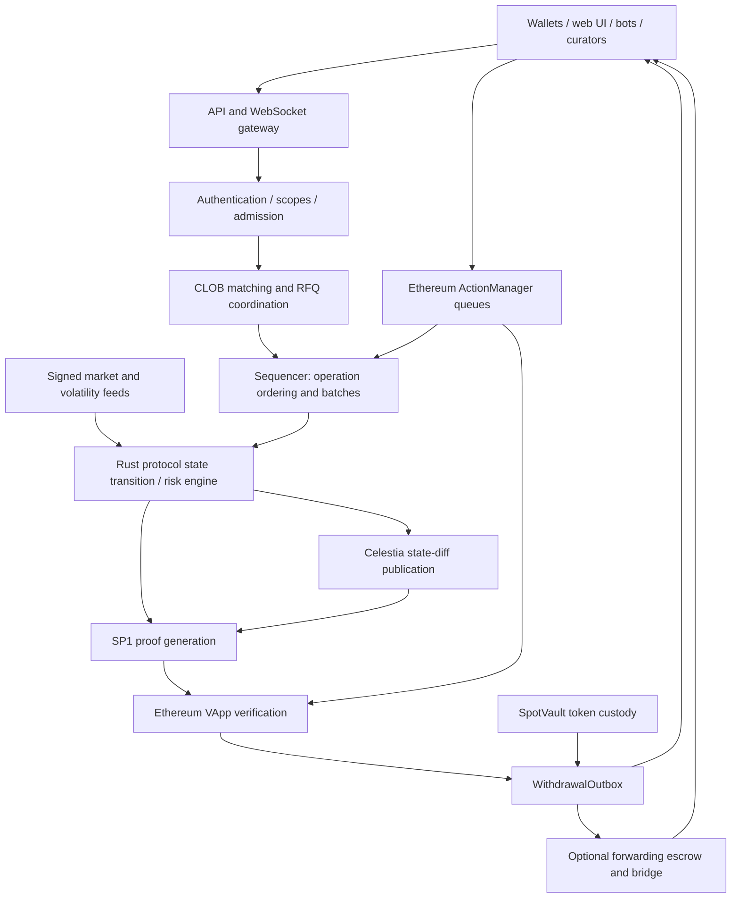

# R2 · Derive: V3 system architecture

> **Reference — this is Derive's design, not ours.** Our design: [04-pool-architecture.md](../04-pool-architecture.md) · index: [docs/README.md](../README.md)

This is a logical architecture reconstructed from deployed Solidity, shipped browser code, public API responses and official documentation. Boxes do not imply independently deployed microservices. Private backend implementation and the Rust guest were not available for source-level reconstruction.

Terminology: **CLOB** = central limit order book; **RFQ** = request for quote; **DA** = data availability; **zkVM** = virtual machine whose execution can be cryptographically proved; **SP1** = the named proving platform. **IM/MM** mean initial/maintenance margin, **NAV** means net asset value, and **FIFO** means first in, first out.

## Architecture in one diagram



**DOCUMENTED:** centralized API/matching service operated by Lyra Technologies Corp / Lyra Tech; Rust protocol logic proved through SP1; state-diff data availability on Celestia; Ethereum V3 settlement. The V3 design is not the legacy OP Stack Derive Chain.

**SOURCE:** the VApp calls an SP1 verifier, binds public/admin action accumulators and withdrawal data, advances DA commitments and invokes the outbox. The Solidity supports this settlement boundary, but does not reveal the private matching implementation or prove the complete content of the Rust program.

Sources: [retained introduction](../../evidence/contracts/introduction.txt), [V3 improvements](../../evidence/contracts/v3-improvements.txt), [launch proposal](https://forums.derive.xyz/t/dip-launch-derive-v3/322), [VerifiableApp.sol](../../evidence/contracts/VerifiableApp.sol#L241).

## Component reference

| Component | Responsibility / state | Interface | Evidence and boundary |
|---|---|---|---|
| Web application | Market views, strategy assembly, account views, wallet prompts | Same-origin API proxy; sockets; wallet signing | OBSERVED + SOURCE: Next.js/React/Webpack; original component tree unknown |
| Identity and scope layer | Authenticate owner/session signer; restrict capabilities and subaccounts | EIP-191 login; HTTP headers; WS login | DOCUMENTED; server-only scope checks are not identical to protocol authorization |
| Market-data service | Instruments, tickers, books, risk metadata, signed feeds | Public HTTP/WS | Three HTTP reads validated; no comprehensive subscription test |
| Matching/RFQ service | Coordinate counterparties, order conditions, quotes, fills | Private order/RFQ methods | DOCUMENTED; closed service internals unknown |
| Sequencer | Order operations and produce batches | Trading operations and L1 queues | DOCUMENTED; not the same job as finding counterparties |
| Protocol/risk engine | Account state, positions, margin, liquidation, settlement, vault accounting | Deterministic operations and oracle inputs | DOCUMENTED Rust/zkVM; guest source and reproducible build unavailable |
| Oracle pipeline | Spot, forwards, perps, volatility surface and rates | Signed feeds; public feed endpoint | DOCUMENTED Block Scholes; sample signatures returned but not independently verified |
| Prover | Generate validity proof for program/public values | SP1 proof → VApp | Verifier call SOURCE; active gateway route/version unresolved |
| Data-availability pipeline | Publish state diffs and advance DA commitments | Celestia / VApp public values | DOCUMENTED + SOURCE commitment checks; independent state reconstruction not performed |
| L1 action intake | Commit public/admin actions and expose queue watermarks | ActionManager | SOURCE + CHAIN |
| Custody and payout | Hold tokens, rate-limit/queue/execute withdrawals | SpotVault / WithdrawalOutbox | SOURCE + CHAIN |
| Forwarding | Optional destination-chain escrow sweep and bridge call | WithdrawFactory and keepers | SOURCE; introduces additional operator/bridge dependencies |
| Indexing/reconciliation | Project protocol and chain state into user-facing histories | Operation/batch/history APIs | INFERRED responsibility; database, broker and hosting unknown |

Do not infer PostgreSQL, Redis, Kafka, Kubernetes or a backend programming language from these logical responsibilities. No corresponding evidence was obtained.

## Frontend reconstruction

The [runtime manifest](../../evidence/browser/runtime-manifest.json) records deployed scripts and public resources. The UI displayed version `c75a0dd`; this is not a verified source commit. Captured deployment identifier: `dpl_5zcAYBQDGeVh1G9FjmDhj1eFptmy`.

Focused searches of shipped bundles found:

| Source location | Supported observation |
|---|---|
| [main-app bundle:1](../../evidence/browser/scripts/next_static_chunks_main-app-79935ae808343e1a.js#L1) | `wss://api.derive.xyz/v3/ws` and trading telemetry labels |
| [request-helper bundle:1](../../evidence/browser/scripts/next_static_chunks_989-eaed449e91790940.js#L1) | Same-origin `/api/orderbook` routing, selected GET query parameters and JSON request bodies |
| [order bundle:1](../../evidence/browser/scripts/next_static_chunks_7590-f2582e45a531328d.js#L1) | `public/order_quote` preflight and signed fields passed to `private/order` |
| [trade-page bundle:1](../../evidence/browser/scripts/next_static_chunks_app_%28app%29_trade_%5Bid%5D_page-6c2d15bad6e62a9a.js#L1) | `public/get_margin` usage |
| [socket bundle:1](../../evidence/browser/scripts/next_static_chunks_1973-1ab8f7fe653a38b4.js#L1) | Trading request routing including order, RFQ and execute-quote methods |
| [signing bundle:1](../../evidence/browser/scripts/next_static_chunks_247-a909744b80ac5f8d.js#L1) | `signTypedData` with primary type `Action`, returning signature/nonce/expiry/signer |

These are static observations, not proof every route was exercised. REA parsed four selected bundles; supplemental text searches cover other named files. A generic JavaScript `.get("symbol")` is not evidence of a network endpoint.

Public runtime resources included WalletConnect discovery, Privy app configuration, SIWE nonce, analytics and support services. Their presence does not establish custody arrangements or access to any user's credentials.

## Domain model

| Entity | Meaning / key relationships |
|---|---|
| Account | Wallet owner, fallback subaccount, recipients, account-level metadata/overrides |
| Subaccount | Numeric ID, risk universe, manager/margin type, balances, positions and holds |
| Risk universe | Boundary for supported assets, margin and backstop/loss allocation |
| Instrument | Underlying, product type, expiry/strike/side; maps to protocol asset and sub-ID |
| Action | Signed protocol instruction with owner, signer, nonce, module and encoded data |
| Order / RFQ / Quote | Execution requests and counterparties; not synonymous with a protocol batch |
| Trade / operation | Economic execution and its protocol-processing identity, including `op_uuid` |
| Batch | Ordered state transition progressing through execution, DA, proof and L1 settlement |
| Vault | Managed subaccount plus shares, shareholder requests, fee state and curator controls |
| Withdrawal | Protocol authorization plus an independently tracked L1 payout lifecycle |

Sources: [OpenAPI](../../evidence/interfaces/openapi.json), [selected schemas](../../evidence/interfaces/schema-selection.json), [additional schemas](../../evidence/interfaces/schema-selection-extra.json).

Treat decimal-string amounts as exact values. Protocol e18 encoding, ERC-20 underlying token decimals, price units and USD fee limits are different units. A protocol asset address is not necessarily the deposit token address.

## API transport: tested versus advertised

**OBSERVED:** these method-specific POST requests returned HTTP 200:

| Endpoint | JSON body |
|---|---|
| `https://api.derive.xyz/v3/public/get_risk_universes` | `{}` |
| `https://testnet.api.derive.xyz/v3/public/get_risk_universes` | `{}` |
| `https://api.derive.xyz/v3/public/get_latest_signed_feeds` | `{"currency":"ETH","expiry":0}` |

The retained OpenAPI is version 3.1 and labels the API version `0.2.0`. Requests send method parameters directly as the body. Returned envelopes had `id` and `result`, but no `jsonrpc` field; the generic JSON-RPC prose is not an exact description of the observed HTTP envelope. Do not guess a `/jsonrpc` route.

The browser proxy also exposes GET-style reads under `/api/orderbook/public/...`; it is a different frontend transport surface, not a contradiction of the direct POST tests.

Evidence: [validation log](../../evidence/interfaces/public-validation.json), [production universes](../../evidence/interfaces/production-risk-universes.response.json), [testnet universes](../../evidence/interfaces/testnet-risk-universes.response.json), [signed feeds](../../evidence/interfaces/production-eth-signed-feeds.response.json).

## Authentication and action signing

**DOCUMENTED.** API login signs a millisecond timestamp string with EIP-191. HTTP carries `X-DeriveWallet`, `X-DeriveTimestamp` and `X-DeriveSignature`; WebSocket uses `public/login`. Login is not an instruction to trade or withdraw.

Economic actions use this EIP-712 primary type:

```text
Action(uint256 subaccountId,uint256 nonce,address module,bytes data,uint256 expiry,address owner,address signer)
```

| Domain field | Documented value |
|---|---|
| name | `Matching` |
| version | `1.0` |
| chainId | `1` mainnet; `11155111` Sepolia |
| verifyingContract | `0xeB8d770ec18DB98Db922E9D83260A585b9F0DeAD` |

The verifying-contract domain is **not** the current V3 ActionManager address. Do not substitute the proxy address because it looks newer.

Order data binds protocol asset/sub-ID, price limit, size, fee bound, recipient ID and direction. A market order still needs a signed price bound. Some HTTP fields are server-side execution instructions rather than signed economic constraints.

The owner can delegate to a session signer. Protocol-enforced scopes and server-only scopes such as IP/account metadata checks must be distinguished. Empty subaccount restrictions mean unrestricted subaccount coverage; revocation has a cooldown. Documentation also contains inconsistent nonce-window descriptions. Implementations need test vectors and account-specific scope tests rather than broad defaults.

Sources: [action signing](../../evidence/interfaces/authentication__action-signing.md.txt), [session login](../../evidence/interfaces/authentication__session-login.md.txt), [session keys](../../evidence/interfaces/authentication__session-keys.md.txt), [access scopes](../../evidence/interfaces/authentication__access-scopes.md.txt).

## Order and batch lifecycle

```mermaid
sequenceDiagram
    participant C as Client / wallet
    participant A as Trading API
    participant R as Protocol / sequencer
    participant P as DA / prover
    participant E as Ethereum VApp
    C->>A: Instrument data, quote and margin preview
    A-->>C: Indicative executable terms / simulation
    C->>C: Validate and sign exact action
    C->>A: Order or RFQ execution
    A-->>C: Acceptance / rejection, order and trade identifiers
    A->>R: Matched operation
    R->>R: Apply authorized state transition and risk checks
    R->>P: Batch, state diff and witness inputs
    P->>E: Proof, public values and withdrawals
    E->>E: Verify proof and update committed root
    E-->>C: Chain events; payout may remain queued
```

This diagram expresses documented responsibilities, not a recovered internal call graph. Exact pre-matching/post-matching check placement is unknown.

Order outcomes include resting, partial/full fill, cancellation, rejection and expiry. Documented order features include GTC, post-only, FOK/IOC, conditional orders and TWAP. Reduce-only is restricted to non-resting execution; atomic replace can guard against intervening filled amounts. Source: [order types](../../evidence/interfaces/trading__order-types.md.txt).

A related operation/batch progresses through:

```text
Batching → Executing → Da → Proving → Settling → Settled
                     (stage-specific errors are possible)
```

Track order ID, trade/operation ID and batch state separately. A timed-out client should reconcile by identity before retrying; an acknowledged order is not an exactly-once application guarantee. A processed escape action can have a skip reason and no payout. Sources: [transaction history](../../evidence/interfaces/api-reference__system__publicget_transaction.md.txt), [L1 action history](../../evidence/interfaces/api-reference__onchain-actions__publicget_onchain_action_history.md.txt).

## Risk, liquidation and settlement

### Margin

**DOCUMENTED.** Standard margin uses position-level requirements and defined offsets, plus collateral treatment. Portfolio margin revalues portfolio exposures under scenarios. It is not a universal claim that any correlated long cancels any short.

For PM2, each currency's worst scenario loss is computed independently and then aggregated. Favorable ETH performance does not automatically cancel BTC's worst-case loss. A public margin preview can return before/after initial and maintenance margin and trade validity, but it does not replace runtime checks.

Sources: [standard margin](../../evidence/interfaces/standard-margin.md.txt), [portfolio margin](../../evidence/interfaces/portfolio-margin.md.txt), [managers/universes](../../evidence/interfaces/trading__managers-and-risk-universes.md.txt).

### Oracle

Current documentation names Block Scholes. Inputs include spot, forward, perp, SVI volatility parameters and rates; feeds are shared by market across universes. Confidence contingencies increase initial margin, not maintenance margin directly. That does not mean changed prices cannot affect liquidation eligibility.

A real ETH feed response contained timestamps, deadlines, confidence and two signatures. We did not verify signatures or establish the signers' operational identities. ZK validity establishes compliance with the proved program and inputs; it does not establish that an external price represents economic reality.

Source: [oracle documentation](../../evidence/interfaces/oracles.md.txt).

### Liquidation and backstop

Documented liquidations auction proportional portfolio bundles. Solvent portfolios are offered at a discount; insolvent auctions can be funded by the universe's Security Module. Residual loss can be allocated within that universe, with temporary balance-operation constraints and phased margin effects. This is not an unconditional guarantee against losses.

The `price_limit` description is inconsistent about whole-account versus filled-portion units. The older blanket “10% liquidation fee” was not verified as a current V3 constant. Sources: [liquidations](../../evidence/interfaces/liquidations.md.txt), [parameters](../../evidence/interfaces/liquidation-parameters.md.txt).

### Expiry

Options cash-settle into the universe cash asset. Documentation specifies a 30-minute spot TWAP, published through cumulative price-times-seconds aggregates:

```text
window_start = expiry - window_seconds
elapsed = min(feed_timestamp, expiry) - window_start
settlement = (spot_aggregate_latest - spot_aggregate_start) / elapsed
```

Use seconds consistently and require a meaningful positive elapsed interval. Dividing a partially accumulated feed by a fixed 1,800 seconds is incorrect. An interim aggregate is not evidence the final expiry observation has arrived. Source: [settlement documentation](../../evidence/interfaces/settlement.md.txt).

## Deposits, withdrawals and vault state

- **Deposits:** direct L1 or registered deterministic deposit addresses; detect/confirm/apply stages and fallback routing. Deposit-address registration is stateful and was not called.
- **Transfers:** internal spot transfers, external transfers, position transfers and L1 withdrawals are distinct actions. Position transfers require both parties' authorization.
- **Withdrawals:** underlying-token units, recipient whitelist/scope checks, operation processing and separate L1 outbox payout. `force_batch` is not a security bypass.
- **Vault requests:** FIFO shareholder queues with holds, signed curator mint/burn actions, nonce/user-action binding, slippage and margin constraints. Curators poll; the described queue has no dedicated WS channel.
- **Vault fees:** share dilution, high-water mark and configured management/performance fees. Documented management settlement cap is 2.5% of NAV per settlement, not a universal annual fee. Zero outstanding shares permanently closes a vault per the winddown guide.

Sources: [deposits](../../evidence/interfaces/getting-started__depositing.md.txt), [transfers](../../evidence/interfaces/trading__transfers-withdrawals.md.txt), [vault requests](../../evidence/interfaces/vaults__deposits-withdrawals.md.txt), [vault fees](../../evidence/interfaces/vaults__fees.md.txt), [winddowns](../../evidence/interfaces/vaults__winddowns.md.txt).

## Unresolved discrepancies

| Evidence conflict | Safe integration treatment |
|---|---|
| Live universe 2 named `MIDCAP`; prose calls it Hype | Discover current universe/instrument metadata; do not hardcode from prose |
| Live minimum-deposit metadata `5`; onboarding says $10 | No minimum deposit was transaction-tested; verify units and active behavior |
| PM document lines 412–416 retain risk-assessor language; V3 proposal says removed | Do not assert active guest logic from either claim alone |
| Public spot fee table versus “free” documentation | Use executable quote/account tier and disclose total cost |
| Generic JSON-RPC prose versus observed HTTP envelope | Follow validated transport and current schema |

These are documentation/interface mismatches, not demonstrated exploits. Resolving them requires maintained specifications, test vectors and, for protocol semantics, the exact deployed guest build.
