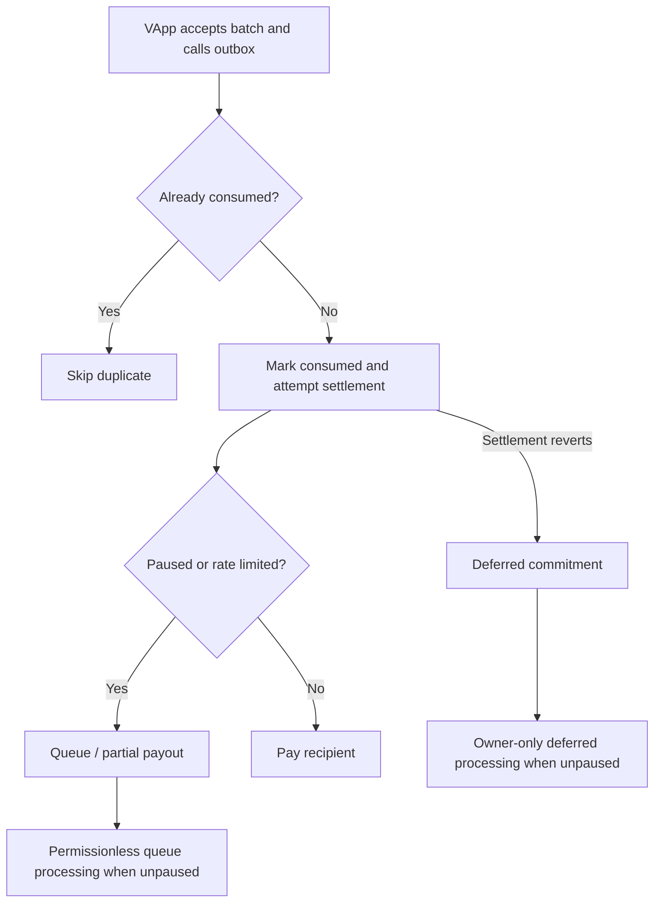

# R3 · Derive: contracts and trust boundaries

> **Reference — this is Derive's design, not ours.** Our design: [04-pool-architecture.md](../04-pool-architecture.md) · index: [docs/README.md](../README.md)

This is source inspection plus a pinned deployment snapshot, not an exploit assessment or full audit. Ethereum reads used one public RPC provider at block **26,285,655** (`0x1911657`), timestamp **2026-10-27 17:50:47 UTC**.

## Deployment map

| Component | Mainnet address | Implementation at pinned block |
|---|---|---|
| ActionManager | `0xE366CcA474968e33b777E13905829A3b800CFAD3` | `0x42Fd440db1b84E95B4Ab6A8Ec5fc3073B1c0A4E5` |
| VApp | `0xd330145C17fB6EF2a21ACf1275Ce683A305F58BB` | `0x3d35cA539242a2b5f7a08340F8b96006EdEB91CB` |
| WithdrawalOutbox | `0x7c743D79C9C595cE332314503d84cBBb4E85FA63` | `0xda213F6af45A7d6Dc728BAB03fA4a1d81ff2B418` |
| SpotVault | `0x2e7dF4fAf35a1599979C7E764444e112d936ec42` | `0x5D6d9D01a79625d5175D68A4B7Eb1fF390438245` |
| WithdrawFactory | `0xFec48bBC648bd2284520d862Ec67fc68F709915e` | Standalone contract |

Evidence: [pinned calls and EIP-1967 slots](..../../evidence/MANIFEST.md#evidencecontractsrpcstatepinnedjson), [SDK deployment mapping](..../../evidence/MANIFEST.md#evidencecontractspymaincontractstxt), [official contract list](..../../evidence/MANIFEST.md#evidencecontractscontractsdoctxt).

Sourcify returned `exact_match` for the inspected ActionManager, VApp and Outbox implementations and WithdrawFactory, and `match` for SpotVault/proxy artifacts. These are verification-service results, not our local bytecode recompilation. Implementation metadata identifies Solidity 0.8.34 with optimizer disabled; proxy metadata identifies 0.8.35. No semantic V3.x release was mapped to these implementations.

One Sourcify VApp proxy-resolution field said `isProxy=false`; verified TransparentUpgradeableProxy source plus the EIP-1967 implementation slot provide stronger evidence for the proxy relationship. Do not rely on that isolated metadata flag.

### Documented Sepolia addresses

| Component | Address |
|---|---|
| ActionManager | `0xd3625eCf97E5554C62A48Ac1c9284C9dCeFceB68` |
| VApp | `0x1573bde26338A9E6AA358638679A796c81E33246` |
| WithdrawalOutbox | `0xFbB62CE2BbFdFdc8a60DDC22115aC29cf91B4566` |
| SpotVault | `0x3FB79aafCD401CDD19e3d729241545955DDE0D48` |
| WithdrawFactory | `0x6A8566c585903E4558A9BE722FFa55f173c719ef` |

Use the [retained Sepolia mapping](..../../evidence/MANIFEST.md#evidencecontractspysepoliacontractstxt) as the implementation input and recheck before sending funds. Testnet API reads succeeded, but these testnet contracts were not used for transactions during research.

## Contract responsibilities

### ActionManager: authenticated L1 intake is not the entire protocol

[OnchainActionManager.sol](..../../evidence/MANIFEST.md#evidencecontractsonchainactionmanagersol) maintains separate SHA-256 public/admin accumulators. Generic actions commit sender, type and encoded data. Accumulator membership commits what was submitted; it does not, by itself, prove all guest-level administrative semantics were authorized.

The direct L1 withdrawal-action fee was **0.002 ETH** in source and the pinned RPC response. This is not a universal fee for every API withdrawal. `forceBatch` requests expedited batching; it does not skip authorization, validity proofs or outbox limits.

Sources: [action append/withdraw logic:185](..../../evidence/MANIFEST.md#evidencecontractsonchainactionmanagersol#L185), [queue processing:262](..../../evidence/MANIFEST.md#evidencecontractsonchainactionmanagersol#L262), [pinned fee read](..../../evidence/MANIFEST.md#evidencecontractsrpcstatepinnedjson).

### VApp: proof-bound state commitment

[VerifiableApp.sol:241](..../../evidence/MANIFEST.md#evidencecontractsverifiableappsol#L241) exposes `submitBatch`. Its visible checks:

1. Enforce the configured batch submitter, unless submission is open.
2. Require the supplied old root to match the committed root.
3. Check operation timestamp ordering and reject future maximum timestamps.
4. Validate public/admin accumulator indexes and submitted accumulator values.
5. Bind withdrawal calldata to the proof's withdrawal digest.
6. Check chained Celestia anchor/commitment inputs and recency.
7. Build public values and call the SP1 verifier.
8. Advance the state root and queue watermarks, then invoke the outbox.

The public values comprise **16 ABI words**: old/new state roots; old/new public accumulator; old/new admin accumulator; withdrawal digest; minimum/maximum operation timestamps; previous/new DA height/hash; previous/new blob commitments; oldest header time.

The key source line is [VerifiableApp.sol:311](..../../evidence/MANIFEST.md#evidencecontractsverifiableappsol#L311):

```solidity
ISP1Verifier(verifier).verifyProof(programVKey, publicValues, proofBytes);
```

At the pinned block:

- Verifier: `0x3b6041173b80e77f038f3f2c0f9744f04837185e`, identified as an SP1VerifierGateway in retained source.
- Program verification key: `0x008dcff8e9d15e87916a63645d1075cb1d545b5bd1f40a3ba05b407f2ffa543b`.
- Maximum DA header age: **172,800 seconds / 2 days**.

The contract comments say the guest proves Celestia light-client/inclusion logic. The guest was not inspected, so the comments establish intended design, not independently verified circuit implementation. Documentation names SP1/Hypercube/PLONK; the gateway's active proof route/version was not resolved.

### SpotVault: token custody

[SpotVault.sol:30](..../../evidence/MANIFEST.md#evidencecontractsspotvaultsol#L30) holds assets and manages token allowances to the outbox. The owner can enable/disable those allowances. Custody correctness therefore depends on the vault, outbox, upgrade control and authorized token behavior, not only on proof verification.

### WithdrawalOutbox: valid withdrawal does not mean immediate payment

[WithdrawalOutbox.sol:396](..../../evidence/MANIFEST.md#evidencecontractswithdrawaloutboxsol#L396) accepts withdrawal batches only from VApp. It deduplicates withdrawal IDs, attempts settlement and diverts failures to a deferred path.



Important source-backed distinctions:

- Guardian/authorized pauser/owner can pause; only owner unpauses.
- Pausing queues withdrawals rather than necessarily reverting an otherwise valid batch.
- USD-denominated token buckets, FIFO queues and partial payment affect timing.
- `processQueue` is public when unpaused.
- `deferredProcess` is owner-only, commitment checked, nonreentrant and unpaused; it is an unthrottled recovery path.
- A consumed identifier means the withdrawal was handled/deduplicated, not necessarily paid in full.

Sources: [roles:168](..../../evidence/MANIFEST.md#evidencecontractswithdrawaloutboxsol#L168), [deduplication:407](..../../evidence/MANIFEST.md#evidencecontractswithdrawaloutboxsol#L407), [settlement:424](..../../evidence/MANIFEST.md#evidencecontractswithdrawaloutboxsol#L424), [queue processing:463](..../../evidence/MANIFEST.md#evidencecontractswithdrawaloutboxsol#L463), [deferred processing:532](..../../evidence/MANIFEST.md#evidencecontractswithdrawaloutboxsol#L532).

At the snapshot the outbox was **unpaused**, guardian `0x682cd085ac63739a9f44e069e91bb6aa09a312e8`, minimum guardian refill interval **7,200 seconds**. These are observations, not perpetual guarantees.

### WithdrawFactory: additional cross-chain trust

[WithdrawFactory.sol:132](..../../evidence/MANIFEST.md#evidencecontractswithdrawfactorysol#L132) supports deterministic recipient/destination-chain escrows, configured OFT/CCIP routes and owner/keeper processing.

[WithdrawFactory.sol:151](..../../evidence/MANIFEST.md#evidencecontractswithdrawfactorysol#L151) contains an owner-only recovery path that sweeps escrow tokens and transfers them to the owner. This is a material trust boundary. A forwarded withdrawal adds escrow, bridge configuration, keeper liveness and owner recovery authority; it should not be described as identical to a direct L1 payout.

## Governance snapshot and powers

**CHAIN.** All five inspected contracts and the four ProxyAdmins returned owner:

`0x62c004a89edbd7becbdf54e14779b7e7f5b390f7`

The verified owner artifact is a SafeProxy. Pinned reads returned threshold **1**, with **2 owners**:

- `0x12d612647e8bcacec9148e477cade67bd07abc78`
- `0x5f8d40613d49179376a200cc808d322f4331453a`

Evidence: [Safe RPC calls](..../../evidence/MANIFEST.md#evidencecontractsrpcsafepinnedjson), [owner artifact](..../../evidence/MANIFEST.md#evidencecontractsowner0x62c004a89edbd7becbdf54e14779b7e7f5b390f7json).

**Unknown:** whether these owners are themselves controlled by other contracts/organizations; Safe guards/modules; extra timelock enforcement; operational policies. The observed Safe configuration does not establish that one particular person can act unilaterally, but it does not substantiate the launch proposal's described 6-of-8/timelock arrangement either.

| Owner power | Source | Why it matters |
|---|---|---|
| Replace verifier and program key | [VApp:148](..../../evidence/MANIFEST.md#evidencecontractsverifiableappsol#L148) | Changes what program/proof system is accepted |
| Replace committed root, with expected-root check | [VApp:158](..../../evidence/MANIFEST.md#evidencecontractsverifiableappsol#L158) | Owner intervention can alter committed state outside normal batch advancement |
| Replace program key alone | [VApp:166](..../../evidence/MANIFEST.md#evidencecontractsverifiableappsol#L166) | Proof validity is relative to the configured program |
| Reset DA anchor | [VApp:179](..../../evidence/MANIFEST.md#evidencecontractsverifiableappsol#L179) | DA recovery/bootstrap includes privileged trust |
| Set submitter and stall timeout | [VApp:189](..../../evidence/MANIFEST.md#evidencecontractsverifiableappsol#L189), [201](..../../evidence/MANIFEST.md#evidencecontractsverifiableappsol#L201) | Controls sequencing/settlement access and recovery timing |
| Upgrade proxies | [ProxyAdmin ownership reads](..../../evidence/MANIFEST.md#evidencecontractsrpcstatepinnedjson) | Current implementation checks are subject to upgrade governance |
| Unpause/recover deferred payouts | [Outbox:168](..../../evidence/MANIFEST.md#evidencecontractswithdrawaloutboxsol#L168), [532](..../../evidence/MANIFEST.md#evidencecontractswithdrawaloutboxsol#L532) | Some recovery paths depend on privileged action |

This is why “secured by validity proofs” must be qualified by upgrade, oracle and operational trust.

## Stalled-operator recovery: what it actually does

The launch proposal described a two-week window. The deployed getter returned **2,419,200 seconds / 28 days**, matching initialization in [VApp:141](..../../evidence/MANIFEST.md#evidencecontractsverifiableappsol#L141).

[clearBatchSubmitter:217](..../../evidence/MANIFEST.md#evidencecontractsverifiableappsol#L217) requires the oldest eligible, unconsumed timestamped L1 action to have waited through that timeout. An empty queue is not a stall; pre-timestamp historical backlog does not itself arm the switch.

On success it sets the exclusive submitter to zero, allowing someone else to submit a valid batch. It does **not**:

- Transfer funds directly to the caller.
- Verify a simple user Merkle proof and release a balance.
- Remove the requirement for the right state/witness, proof generation and valid DA progression.
- Automatically unpause the outbox or resolve owner-only deferred payments.

Therefore this is an alternate-producer mechanism, not a demonstrated unconditional user exit. Practical independent recovery was not exercised.

## Trust matrix

| Layer | What it helps enforce | What it does not guarantee |
|---|---|---|
| Wallet/action signatures | Authorization of bound fields | Fair prices, all HTTP flags, safe delegated scopes |
| Matching service | Order/RFQ coordination | Permissionless access, fair ordering or continuous liquidity |
| Risk program + proof | Valid state transitions under selected program and inputs | Correct economic model, honest market prices or bug-free guest |
| Ethereum contracts | Root/queue/proof/payout rules in current implementation | Immutable rules while owners/upgrades remain powerful |
| Celestia commitments | DA anchoring under configured proof rules | A demonstrated third-party recovery workflow |
| Oracle feeds | Authenticated external market inputs under protocol rules | Objective truth, outage immunity or manipulation-free markets |
| Outbox controls | Deduplication, throttling and controlled recovery | Immediate payout or fully permissionless every-path recovery |
| Cross-chain forwarding | Routed withdrawal convenience | Removal of bridge/keeper/owner dependencies |

## Source availability and audit limits

The inspected public SDKs expose API bindings and deployment data, not the full V3 trading/risk engine:

- [derive-py pinned deployment file](https://github.com/derivexyz/derive-py/blob/4d36e888fe4a7e7bd37c0ca85523e83eb1da1e06/derive_py/data/abis/ethereum/contracts.json).
- [derive-ts pinned ActionManager ABI](https://github.com/derivexyz/derive-ts/blob/f15f1b8776a7535f2609bf9130265d1a67704077/src/abis/onchainActionManager.ts).
- [derive-rs pinned package manifest](https://github.com/derivexyz/derive-rs/blob/5b715399874aa376969ace7c3e541181f9997281/Cargo.toml).
- [VApp verification artifact](https://sourcify.dev/server/v2/contract/1/0x3d35cA539242a2b5f7a08340F8b96006EdEB91CB?fields=all).

Legacy `v2-core`/`v2-matching` source is not evidence of current V3 guest behavior. Likewise, an SP1 audit is not a Derive application audit. The [V3 audit page](https://www.derive.xyz/v3-audit) makes audit/remediation claims, but a report-to-current-deployed-build mapping was not established in this investigation.

Before relying on the system for new funds, request the exact guest source/build mapping, current audit reports, documented governance control graph, oracle signer policy, DA reconstruction tooling and a tested recovery procedure. These are due-diligence gaps, not proof of exploitation or failure.
