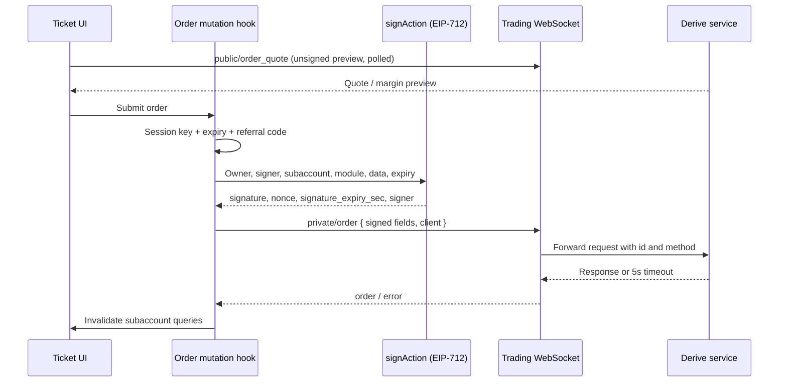

# R4 · Derive: REA order-path trace

> **Reference — this is Derive's design, not ours.** Our design: [04-pool-architecture.md](../04-pool-architecture.md) · index: [docs/README.md](../README.md)

Scope: static trace of the retained Derive browser bundles. No wallet was connected and no order was submitted for this trace. The conclusions describe shipped code syntax, not observed runtime behavior.

## Evidence and coverage

- REA application Evidence: `ev_3698f52c7785b5b66a1b461274ee103f4391aab2c8417752095df94e18dca4a2`.
- Root artifact SHA-256: `cc4cd43bb4ce5b6faf7a378e9ee36909a073ad14c5d07505950e36bca086132b`.
- REA parsed four selected bundles (260 modules); 85 other inventoried scripts remain outside semantic analysis. One additional signing bundle was inspected directly as text and is labeled accordingly.
- Function node IDs and column ranges below are from REA's semantic graph. Source links open the minified bundle at line 1; use the recorded columns to locate the snippet.
- Bundle version displayed by the app: `c75a0dd` (display string, not a verified commit).

## Traced path

## Observations

| # | Location | Finding | Label |
|---|---|---|---|
| 1 | [7590 bundle @50438–50924](../../evidence/browser/scripts/next_static_chunks_7590-f2582e45a531328d.js#L1); REA `jsrg_node_78f49928e6bf5e…` | Order mutation obtains `{signingAccount, sessionKey}` from `getSigningAccount`, computes `expiry = floor(now/1000) + expiryDurationSec`, adds a referral code when required, calls a signer helper with `(owner.addressDEPRECATED, signingAccount, sessionKey, expiry, ticker, params)`, then sends `private/order` and returns `order`. On success it invalidates subaccount queries. | SOURCE, static |
| 2 | [247 bundle @~3355](../../evidence/browser/scripts/next_static_chunks_247-a909744b80ac5f8d.js#L1); direct text inspection | `signAction` defines the EIP-712 type `Action(subaccountId, nonce, module, data, expiry, owner, signer)` and domain `{name:"Matching", version:"1.0", chainId, verifyingContract: matching}`. It requires `sessionKeyExpirySec >= signatureExpirySecs`, uses a fresh nonce, and returns `{signature, nonce, signature_expiry_sec, signer}` with `signer` set to the signing account address. | SOURCE, direct |
| 3 | [7590 bundle @210110–210277](../../evidence/browser/scripts/next_static_chunks_7590-f2582e45a531328d.js#L1); REA `jsrg_node_ef4f3a16c35f6d…` | Quote preflight sends `public/order_quote` with wire params, `subaccount_id`, a fresh nonce, `max_fee:"0"`, `signature:""`, `signer:""` and `signature_expiry_sec = now + expiry_duration`. The query is disabled for zero amount/limit price or incomplete trigger data, and polls while the public socket is ready. | SOURCE, static |
| 4 | [7590 bundle @115819–116148](../../evidence/browser/scripts/next_static_chunks_7590-f2582e45a531328d.js#L1); REA `jsrg_node_b08eabeee6360d…` | RFQ execution first requires the user to own the subaccount, obtains the signing account/session key, signs an execute-quote action with `(owner.addressDEPRECATED, signingAccount, sessionKey, tickers, params, rfqValidUntil)`, then sends `private/execute_quote`. | SOURCE, static |
| 5 | [7590 bundle @211872–212476](../../evidence/browser/scripts/next_static_chunks_7590-f2582e45a531328d.js#L1); REA `jsrg_node_622c622d4b7d83…` | RFQ creation sends `private/send_rfq` with referral metadata and `subaccount_id`. It is separate from quote execution. | SOURCE, static |
| 6 | [1973 bundle @406975–407454](../../evidence/browser/scripts/next_static_chunks_1973-1ab8f7fe653a38b4.js#L1); REA `jsrg_node_2bfd8727e12a18…` | A switch assigns request priority: order/cancel/execute-quote/send-quote/send-RFQ/replace methods return `3`; `private/rfq_get_best_quote` returns `1`; `public/order_quote` and `public/login` return `null`. | SOURCE, static |
| 7 | [1973 bundle @420740–421318](../../evidence/browser/scripts/next_static_chunks_1973-1ab8f7fe653a38b4.js#L1); REA `jsrg_node_b4c5819e8b6921…` | The trading request dispatcher selects a trading or public socket, adds a `client` identifier to order/RFQ/execute-quote methods, records telemetry, sends `{id, method, params}`, and rejects after **5,000 ms** with the method and params in the error. Request IDs are `Date.now() + "_" + counter`. | SOURCE, static |
| 8 | [1973 bundle @206254–211153](../../evidence/browser/scripts/next_static_chunks_1973-1ab8f7fe653a38b4.js#L1); REA `jsrg_node_ad73cd423ee90b…` | A separate relay flow signs permit/transfer descriptions and sets statuses such as `sign=confirmed`, `relay=submitting`. This is not the order signer; mixing the two would overstate what the order path authorizes. | SOURCE, static |

## What this adds to the architecture docs

1. **The quote is explicitly unsigned.** The preflight sends empty `signature`/`signer` and `max_fee:"0"` while still using a fresh nonce and a future expiry. This supports treating quotes as indicative until the final signed action.
2. **Signer and owner are distinct.** The signed message carries both the wallet owner and the session signer; the signer address comes from the signing account, not the connected wallet.
3. **Session-key lifetime is checked client-side.** The signer helper rejects when the session key expires before the action. Server-side enforcement still needs to be assumed or tested separately.
4. **A 5-second client timeout is not a fill guarantee.** The dispatcher rejects locally after 5 s, so a timed-out order may still have reached the service. The UI should reconcile by order/operation identity instead of blindly retrying.
5. **Writes are prioritized differently from reads.** Order/RFQ writes use priority 3, best-quote lookup 1, and quote/login `null`. This is a latency policy, not evidence of fair ordering.
6. **RFQ execution uses the same session-signing pattern.** The taker signs an execute-quote action with an RFQ validity deadline, consistent with the documented maker-quote/taker-execute flow.
7. **Relay signing is a different capability.** Permit/transfer relay signing should not be conflated with trading permission when reasoning about delegated keys.

## Limits

- Minified React output means function names such as `e2` or `eF.U` are inferred from surrounding syntax. The roles above are supported by the visible arguments and call sites, not by original source names.
- REA analyzed four bundles out of 89 inventoried scripts. Unselected modules and dynamic imports remain unknown.
- No runtime breakpoint, network capture or authenticated request was used for this trace. The 5-second timeout and request envelope are static facts; actual server behavior is not established.
- The `addressDEPRECATED` field name is copied from shipped code. It suggests a migration but does not establish which address form the backend currently expects.
- A signed EIP-712 action is not proof that the service accepted or executed an order. Those remain separate lifecycle events.

This trace informed the NEAR prototype's design choices: explicit quote expiry, separate authorization from execution, a conservative request timeout, and status reconciliation instead of assuming a timeout means failure.
